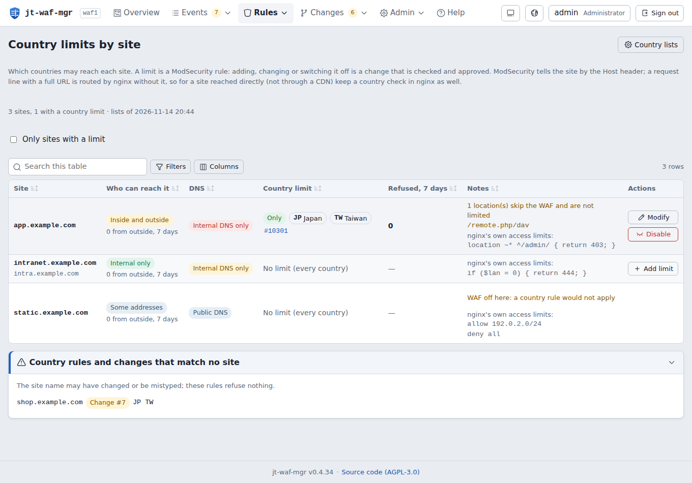
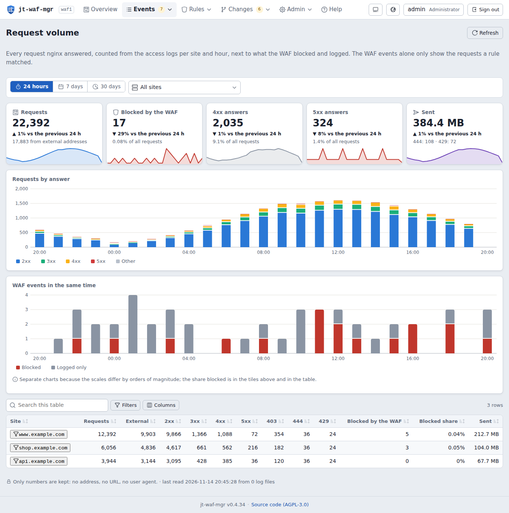

# jt-waf-mgr v0.4.34

**English** · [繁體中文](README_zh-TW.md) · [日本語](README_ja.md)

[](LICENSE)
[](https://github.com/jasoncheng7115/jt-waf-mgr/commits/main)


**🌐 [Project site →](https://jasoncheng7115.github.io/jt-waf-mgr/?lang=en)**

> A self-hosted web manager for **nginx + libmodsecurity v3 + OWASP CRS 4**: read what the WAF did, tune it through
> an evidence-checked, sandbox-tested and approved change workflow, let a self-hosted LLM review the events, and get
> notified on Teams, Telegram, Zulip, Slack, Discord, Nextcloud Talk, e-mail or a signed webhook.
>
> By Jason Tools Co., Ltd. · License: AGPL-3.0


---

## Why jt-waf-mgr?

libmodsecurity v3 has no management interface. Rules, exclusions and blocks are configuration files; tuning means
reading JSON audit logs and editing files by hand on a production reverse proxy. jt-waf-mgr turns the audit log into
something you can read, and every change into a workflow you can trust:

- **See what happened**: blocked / logged, by site, attack type, source (with country and network owner), rule and
  time; "blocked only by the CRS score" first, because those are the likely false positives.
- **Change safely**: templates (exclusion, confident block, redaction, plugin toggle, expert raw rule) → static checks
  (regex sanity, ReDoS) → evidence from the access logs → a throwaway nginx sandbox with the production configuration
  and regression samples → approval → a small root program that tests, reloads, health-checks and restores on failure →
  versions with one-click rollback.
- **Let a model help, never decide alone**: a scheduled analysis with your own OpenAI-compatible LLM server proposes
  narrow blocks for probes, the narrowest exclusion for false positives, and raises alerts — everything is validated by
  the program, loosening always needs a person.
- **Trust the trail**: hash-chained, append-only audit trail anchored outside the database and in syslog; signed
  releases; fingerprints of every nginx / ModSecurity / CRS file; compliance views for ISO/IEC 27001:2022, Taiwan's
  Cyber Security Management Act and OWASP Top 10:2025.

## Features

- **Collector**: the ModSecurity JSON audit log (copytruncate and rename rotation, oversized and malformed records);
  passwords, tokens and other sensitive fields are masked **before** anything is stored.
- **Overview and events**: drag across the timeline to zoom in, or pick any range up to 31 days; filters stay in the
  URL; event detail with every matched rule; one click to draft an exclusion or a block.
- **Temporary IP blocks** (new in 0.4.24, optional): fail2ban on a mail server, a SOAR playbook or an approver blocks
  a single address for a while; one nginx deny list covers every site. See [Temporary IP blocks](#temporary-ip-blocks-optional).
- **Country blocks** (new in 0.4.28, optional): limit a site to some countries, or block some countries, with lists
  from the five regional Internet registries, refreshed daily. Each site's limit is a rule through the change workflow;
  Rules → Country limits shows every site: who may reach it, what was refused, "modify" and "add limit". See [Country blocks](#country-blocks-optional).
- **Request volume** (new in 0.4.23): every request in the nginx access logs, counted per site and hour (2xx, 3xx,
  4xx, 5xx, 403, 444, 429, external, bytes; numbers only, no address, URL or user agent), next to what the WAF
  blocked, so the WAF numbers have a denominator. Switched on or off, and its alerts set, in the admin Settings
  ("Request volume"); optional alerts, off by default: a traffic spike (N times the site's usual hour over the
  previous 7 days) or many 5xx answers.
- **WAF model**: how a request is decided on these sites (engine per site, scoring, thresholds, exclusions,
  confident blocks), drawn from the live configuration.
- **Rules**: every rule with where it comes from (OWASP CRS and its version, a CRS plugin, imported at adoption, a
  change by a person, an API token or the event analysis), hits per day, syntax-highlighted text. New in 0.4.23: who
  wrote each rule, with a filter and per-author counts: OWASP CRS, an OWASP CRS plugin, a third-party plugin,
  ModSecurity base settings, jt-rules (rules jt-waf-mgr generates from a form, and the jt-rules pack) or
  this site (hand-written: imported at adoption, raw rules, nginx vhost files).
- **Change workflow**: single changes or one bundle (one approval, one version, one reload), upload of rule files,
  evidence, sandbox, health URLs, approval rules (the proposer cannot approve; single-admin mode with a fresh one-time
  code for loosening), automatic tightening within strict limits, rollback.
- **Event analysis (self-hosted LLM)**: candidates grouped by the path a rule sees; one schema-constrained request per
  batch; the program, not the model, decides what is proposed (narrow anchored regex, never matching common paths,
  regression samples or paths the organisation itself uses; exclusions are one exact path, specific rules and
  request parts only, and need a one-time code to approve); outside sources probing for secret, backup or configuration
  file names, or one address trying many paths, are probes by the program's own rule; a path called an attack before
  is not loosened on one "false positive" verdict; summaries of every run.
  **AI can be wrong, in both directions**: the model only suggests; loosening always needs a person, only tightening
  that passed every check may apply on its own. Which LLM to use: see
  [Event analysis: which LLM](#event-analysis-which-llm).
- **Alerts to follow up**: an attack the site may have answered, users hit by a false positive, an attack in progress,
  outside configuration changes, integrity problems, failed applies or backups — open until an approver marks them
  handled with a note; reminded until then.
- **Notifications**: e-mail (SMTP, text + HTML), Telegram, Microsoft Teams (Workflows / Adaptive Card), Slack,
  Discord, Zulip, Nextcloud Talk and a generic webhook (HMAC-SHA256 signature); a matrix of events × channels; a test
  per channel; retries, rate limits and delivery records. Values from requests are never markup, links or mentions.
- **OWASP CRS updates** (optional, off by default): a sandboxed daily check takes the newest release of the major
  version in use once it has been out a week, keeps it only with a valid signature by the pinned CRS release key and
  stages it; the CRS page shows what is in use, what is new and what is verified. Switching to it (or back to a kept
  version) is a change: both versions run the same recent requests in the sandbox, a person approves, the root
  program re-verifies the signature, unpacks it itself, switches the crs link and switches back on any failure; 3
  versions are kept to roll back. A host without the CRS can install CRS 4 the same way (its Includes go right after
  modsecurity.conf).
- **Log servers (syslog / SIEM)**: up to 8 destinations, each with its own protocol (local socket, UDP, TCP, TLS),
  record format (JSON, CEF, LEEF 2.0, GELF 1.1, key=value) and content (audit records, WAF events, alerts); its own
  queue and retries; a test send that shows exactly what went out.
- **Accounts**: scrypt passwords, TOTP required for approver / admin, lockout, password policy with history and
  ageing, account expiry and review; API tokens with scopes and allowed source networks (tokens can propose, never
  approve). Recovery on the host: see [Accounts and recovery](#accounts-and-recovery).
- **Integrity and compliance**: system check page, compliance page, daily verified backups with download (one-time
  code), configuration change history with attribution (jt-waf-mgr, registered automation, or outside); for a change
  from outside, what changed in each file (secret-looking values masked) and who was logged in to the host meanwhile.
- **Interface**: English, 繁體中文 and 日本語; light and dark; phones and tablets; GeoIP (MaxMind GeoLite2, downloaded
  by its own sandboxed job) with a world map of where requests come from, drawn in the page (no map service).

| | |
|---|---|
|  |  |
|  |  |
|  |  |
|  |  |

## Requirements

- Debian 12 / 13 or Ubuntu 24.04 (22.04's libmodsecurity package is too old: build 3.0.9 or later yourself), **Python 3.11 or newer — standard library only, no pip, no wheels**: the
  service installs offline.
- nginx with the ModSecurity-nginx connector, libmodsecurity 3.0.9+, `SecAuditLogFormat JSON`; OWASP CRS 4.x, which
  jt-waf-mgr can download, verify and install for you (see [The OWASP CRS](#the-owasp-crs));
  rotate the audit log with `copytruncate` (libmodsecurity does not reopen it on reload). Starting from a fresh nginx
  or without CRS 4: see the [ModSecurity installation guide](docs/MODSECURITY.md); hosts without internet access:
  the [offline installation guide](docs/OFFLINE.md). Adoption also works without site
  rule files (empty managed files are added next to the CRS rules).
- Optional: an OpenAI-compatible LLM server on your network (llama.cpp, vLLM, Ollama…) for the event analysis (see
  [which LLM](#event-analysis-which-llm)); a MaxMind account for GeoIP.

## Install

```sh
openssl dgst -sha256 -verify release-key.pem -signature jt-waf-mgr-0.4.34.tar.gz.sig jt-waf-mgr-0.4.34.tar.gz
tar xzf jt-waf-mgr-0.4.34.tar.gz && cd jt-waf-mgr-0.4.34
sudo ./install.sh                             # verifies every file and the release signature first
sudo jt-waf-mgr check                         # parses the nginx / ModSecurity configuration
sudo jt-waf-mgr user add alice --role admin   # prints a temporary password
```

### Connect to the management interface

The service listens on `127.0.0.1:8095` only (`[server] listen` in `/etc/jt-waf-mgr/config.toml`) and is never exposed
directly: nginx proxies a management vhost to it. The release installs an example vhost at
`/etc/jt-waf-mgr/nginx-vhost.conf.example`. Copy it to the nginx vhost directory, for example:

```sh
sudo cp /etc/jt-waf-mgr/nginx-vhost.conf.example /etc/nginx/sites-available/waf.example.com.conf
sudo ln -s /etc/nginx/sites-available/waf.example.com.conf /etc/nginx/sites-enabled/
# (or copy it to /etc/nginx/conf.d/waf.example.com.conf)
```

In the copy, set:

- `server_name`: the name you will open, for example `waf.example.com`;
- `ssl_certificate` / `ssl_certificate_key`: the certificate (see below);
- the `allow` lines: your internal networks only (or narrower: your admin network); the rest stays `deny all`.

Then `sudo nginx -t && sudo systemctl reload nginx`. The vhost has `modsecurity off` on purpose: the interface shows
attack strings and would trigger the WAF on itself. Optional: the commented `limit_req` block in the example adds a
brute-force brake in front of the sign-in.

The certificate, one of:

- your organisation's internal CA, or an existing wildcard certificate;
- Let's Encrypt: the management site is internal-only, so the HTTP-01 challenge usually can't reach it; use the
  DNS-01 challenge (certbot with your DNS provider's plugin), or issue it on a public host and copy it over;
- for a lab only, a self-signed certificate (browsers will warn):

```sh
sudo openssl req -x509 -newkey rsa:3072 -nodes -days 825 -keyout /etc/ssl/private/waf.key -out /etc/ssl/certs/waf.crt -subj "/CN=waf.example.com" -addext "subjectAltName=DNS:waf.example.com"
```

Then open `https://waf.example.com` (the name you set) and sign in with the temporary password that
`jt-waf-mgr user add` printed. The first sign-in forces a new password and the TOTP two-factor setup. Operational
settings (GeoIP, LLM, analysis, notifications, request volume, networks, policy) are made in the web interface;
`/etc/jt-waf-mgr/config.toml` only holds what the program needs to start.

### Let jt-waf-mgr change rules

jt-waf-mgr writes only ModSecurity files and never writes nginx configuration. It reads nginx's configuration (to
find the sites and ModSecurity's main file), runs `nginx -t` and reloads nginx. The management vhost and
`modsecurity on;` in nginx are your own one-time edits. The one exception is optional: the temporary IP block list, a file of `deny` lines that you include once yourself.

To let jt-waf-mgr change rules: arm the apply program (`sudo ./install.sh --enable-apply`), set the health check URLs,
and adopt the existing rule files under Rules → Managed rules (an admin approves the adoption like any change).
Nothing is written before that. Adoption also works without site rule files.

### The OWASP CRS

jt-waf-mgr handles the CRS. A new host only needs nginx with the ModSecurity module, a `modsecurity.conf` with
`SecAuditLogFormat JSON`, a main file that Includes `modsecurity.conf`, and `modsecurity on;` plus
`modsecurity_rules_file …` in nginx ([ModSecurity installation guide](docs/MODSECURITY.md)). Then:

1. Switch on "Keep the CRS current from here" on the CRS page.
2. jt-waf-mgr downloads the newest CRS 4.x once it has been out `wait_days` (default 7) and verifies it against the
   pinned CRS signing key.
3. "Compare in the sandbox and propose installing" creates a change.
4. After a person approves it, jt-waf-mgr installs `crs-<version>`, the `crs` link and `crs-setup.conf`, and inserts
   the Includes right after `modsecurity.conf`.
5. Adoption then adds jt-waf-mgr's managed rule files around the CRS rules.

Later CRS updates work the same way: download, verify, compare in the sandbox, a person approves, install; 3 versions
are kept to roll back. Installing the CRS by hand also works (see the guide).

### Temporary IP blocks (optional)

Other systems, for example fail2ban on a mail server whose web mail is behind this proxy, can block a single address
for a while through the API (scope `blocks:write`); approvers can do it on the Blocked IPs page. jt-waf-mgr writes the
list to one nginx file of `deny` lines, which covers every site, also those without ModSecurity. To use it:

1. Create the file and include it once inside `http { }` in nginx.conf, then test and reload:
   ```sh
   sudo install -D -m 644 /dev/null /etc/nginx/jt-waf-mgr/blocked-ips.conf
   # in nginx.conf, inside http { }:   include /etc/nginx/jt-waf-mgr/blocked-ips.conf;
   sudo nginx -t && sudo systemctl reload nginx
   ```
2. Settings → Temporary IP blocks: switch it on, and list the networks that must never be blocked (for example a CDN
   in front of your sites).
3. Admin → API tokens: a token with `blocks:write` (and `blocks:read`), limited to the calling host's address.
4. Example: a fail2ban action that blocks and unblocks through the API:
   ```ini
   # /etc/fail2ban/action.d/jt-waf-block.conf  (chmod 600: it holds the token)
   [Definition]
   actionban   = curl -fsS -m 10 -X POST -H "Authorization: Bearer <token>" -H "Content-Type: application/json" \
                 -d '{"ip": "<ip>", "ttl": <bantime>, "source": "<source>", "reason": "fail2ban <name>"}' <waf>/api/v1/blocks
   actionunban = curl -fsS -m 10 -X DELETE -H "Authorization: Bearer <token>" "<waf>/api/v1/blocks/<ip>?source=<source>"
   [Init]
   waf    = https://waf.example.com
   token  = jwm_...
   source = mail1/<name>
   ```
   A jail then uses `action = jt-waf-block`. Keep `bantime` between 60 seconds and 7 days (a longer or permanent ban is
   refused), and keep the jail's own `ignoreip` for internal addresses: they are refused anyway.
 
   Optionally, Settings → Temporary IP blocks → "Block sources that guess secret files automatically": an outside address
   asking for 5 different secret or configuration file names within an hour is blocked for 24 hours by a program rule.
   It reads the WAF events, counts only names that were refused or not found (4xx/5xx), needs at least one unmistakable
   name (.env, .git, keys, dumps, backups) and leaves an address that got a 2xx/3xx for any such name to a person.
   It skips the change workflow and blocks on every site, so it is off by default.

Blocks last 24 hours by default, at most 7 days from a token and 30 days by hand; an approver can extend one and an
admin can make one permanent in the web interface (with a reason; never from a token or a rule). Internal
networks, known scanners, trusted proxies and the protected list are never blocked. nginx checks the address after
`real_ip`, so sites behind a CDN need `set_real_ip_from` / `real_ip_header`. Servers and locations with `allow` /
`deny` lines of their own do not inherit the list; the Blocked IPs page lists them. A block takes effect for new requests within about a minute; connections already open (WebSocket) last until they close. Details: the
[API manual](docs/API.md), section 4.9.

### Country blocks (optional)

Limit one site by where requests come from: only the countries you list ("only Taiwan and Japan"), or every country
except them. Each limit is a ModSecurity rule that goes through the change workflow like any other (checks, sandbox,
approval, rollback); the address lists are data and are refreshed without it.

1. Settings → Country blocks: switch on, then "Update now". A separate, sandboxed job downloads the five registries'
   delegated files (APNIC, ARIN, RIPE NCC, LACNIC, AFRINIC; about 28 MB together), checks each against the registry's
   MD5 file and against its own record counts, and only when all five pass replaces the lists. After that it runs
   once a day. The web service itself never connects to the internet.
2. Changes → New → Country block: the site, "only these countries" or "block these countries", the countries.
   The checks count, from the access logs, how many requests and addresses the rule would have refused and how many
   of those were answered 2xx/3xx (real users it would shut out); the sandbox tests a request from an allowed and from
   a refused country and one from inside.
3. After approval the root apply program writes the list the rule reads (`/etc/nginx/modsec/jt-waf-mgr/countries/`),
   tests nginx and reloads.

Never refused: the internal networks, the known scanners, the trusted proxies and the protected list (Settings →
Temporary IP blocks), so a CDN in front of a site is not shut out. Behind a CDN the site needs `set_real_ip_from` /
`real_ip_header`. The rules run in ModSecurity, so locations with `modsecurity off` are not covered. Registry data
says where an address block was registered, not where its user is (a VPN, a cloud region or a roaming phone can be
elsewhere).

### Accounts and recovery

On the host, as root:

```sh
sudo jt-waf-mgr user list                       # accounts, roles and state (disabled, totp, must-change)
sudo jt-waf-mgr user add alice --role approver  # roles: viewer (default), operator, approver, admin
sudo jt-waf-mgr user unlock alice
sudo jt-waf-mgr user reset alice
sudo jt-waf-mgr user passwd alice
sudo jt-waf-mgr user disable alice              # and: enable
```

- `add` prints a temporary password, which must be changed at the first sign-in.
- `unlock` clears the failed sign-in lock.
- `reset` gives a new temporary password, clears TOTP and forces a change at sign-in: the recovery for a lost phone.
- `passwd` sets a password interactively.
- `disable` / `enable` switch an account off and on again.
- Every one of these changes is written to the audit trail.

### Upgrade

```sh
sudo ./upgrade.sh --check     # every check, nothing changed
sudo ./upgrade.sh             # backup, switch, checks; rolls back by itself on any failure
sudo ./upgrade.sh --rollback  # later, if needed: back to the version (and database) before the upgrade
sudo jt-waf-mgr doctor        # health summary at any time
```

The upgrade verifies the new release with the installed program and the pinned key, refuses while a change is being
applied, keeps a backup in `/var/backups/jt-waf-mgr/` and records every upgrade (and every rollback) in the audit
trail.

### Uninstall

```sh
sudo ./uninstall.sh           # remove the service and the program; keep data and configuration
sudo ./uninstall.sh --purge   # also remove /var/lib/jt-waf-mgr, /etc/jt-waf-mgr and the jtwaf user
```

The nginx configuration is never touched: remove the management vhost yourself. If the rule files were adopted, the
managed files in `/etc/nginx/modsec/jt-waf-mgr/` stay in place and nginx keeps loading them; maintain them by hand from then on.

## Event analysis: which LLM

The analysis always runs on your own, self-hosted LLM server.

- **Server**: OpenAI-compatible (llama.cpp server, vLLM, Ollama) with JSON-schema-constrained answers. Without them,
  plain JSON mode is used and answers are less reliable.
- **Model**: an instruction model of about 14B parameters or more, at 4-bit quantization or better; 27–32B dense or a
  30B-class MoE is recommended. Versions: Qwen 3.8 or later, Gemma 4 or later (older versions are not recommended), or gpt-oss-20b.
- **Context window**: at least 16k tokens. Measured: one batch of 11 candidates used about 3k input and 3.5k output
  tokens and took about 85 seconds on the production server.
- **Smaller models** (8B and below) or 2–3-bit quantizations contradict themselves more between runs: in production a
  3-bit-quantized model called the same probe an attack twice and a false positive once. jt-waf-mgr counters this with
  program-side rules for scanner patterns and a verdict history, but a stronger model helps.
- **Slow hardware**: raise the LLM timeout in Settings (up to 900 s).

The AI may be wrong. Automatic application only ever tightens (allow → block); loosening always needs a person.

## Integrations

- **Wazuh**: a decoder and rules for jt-waf-mgr's own records are in [deploy/wazuh](deploy/wazuh/README.md) (send the
  audit trail and events by syslog); an active response can call the IP block API.
- **jt-wazuh-mgr** (a separate Jason Tools project that manages Wazuh) proposes WAF changes and temporary blocks with
  its own API token; it never approves.
- **Graylog**: Settings → log destinations → format GELF over UDP, TCP or TLS to a GELF input; site, rule, outcome,
  source and country arrive as separate fields.
- **Other SIEM**: up to 8 syslog destinations, each with its own protocol, format (JSON, CEF, LEEF, GELF, key=value,
  RFC 3164 / 5424) and content (audit trail, events, alerts).
- **fail2ban**: the IP blocks page shows a ready action that blocks and unblocks through the API.
- **Chat and webhooks**: e-mail, Telegram, Teams, Slack, Discord, Zulip, Nextcloud Talk, an HMAC-signed webhook.

## API for integrations

A SIEM, a SOAR playbook or a script connects with an API token (created by an admin, with scopes and allowed source
addresses; a token can propose changes, never approve them). See the [API manual](docs/API.md).

## Security (OWASP Top 10:2025)

See [SECURITY.md](SECURITY.md) and [docs/COMPLIANCE.md](docs/COMPLIANCE.md). Please report vulnerabilities privately.

- The web service listens on loopback, runs unprivileged and never connects out; only the apply program runs as root.
  It re-validates every request (allowed directives only, checksums, no manual edits on disk) and writes only the
  managed files. GeoIP downloads, the LLM analysis and notifications each run in their own sandboxed one-shot unit.
- Strict CSP without `unsafe-inline`; everything that comes from a request (URLs, user agents, matched data, the
  model's text) is rendered as text.
- Sensitive values are masked before they reach the database; secrets in settings are write-only.
- A01: roles viewer / operator / approver / admin, API token scopes and source networks; tokens never approve.
- A04 / A07: scrypt, TOTP with replay protection, lockout, one-time codes for sensitive actions (limited attempts).
- A08: signed release manifest checked by the installer, the service and the apply program; hash-chained audit trail.
- A09: every write is audited, also to syslog (one JSON line, control characters escaped).
- Every release passes a test plan ([TEST_PLAN.md](TEST_PLAN.md)): unit tests, a browser test of every page, a security
  scan of every route, an OWASP ZAP active scan, an independent review, upgrade and rollback tests.

## Stack

| Layer | Choice |
|------|--------|
| Backend | Python 3.11+ standard library (http.server, sqlite3, hashlib.scrypt, tomllib, urllib, smtplib) |
| Database | SQLite (WAL), append-only audit table with triggers |
| Frontend | Vue 3 · Vite · own i18n (no runtime compilation, CSP-friendly) · Iconoir icons |
| WAF | nginx · libmodsecurity v3 · ModSecurity-nginx · OWASP CRS 4 |
| Deploy | systemd units (service, apply, GeoIP, analysis, notifications); no Docker needed |

## Project layout

```
jt-waf-mgr/
├── jtwafmgr/            # the program (collector, web API, change workflow, apply, analysis, notifications, integrity)
│   ├── collector/       # ModSecurity audit log reader
│   ├── web/             # HTTP server, routes
│   └── static/          # the built web interface
├── frontend/            # Vue 3 source of the web interface
├── deploy/              # systemd units, nginx example, release key, Wazuh rule drafts, ZAP baseline
├── docs/                # spec, API contracts, compliance mapping, project site
├── tests/               # unit and integration tests (synthetic data only)
├── tools/               # build, release, preflight, browser test, security scan, ZAP scan
├── install.sh · upgrade.sh · uninstall.sh
└── TEST_PLAN.md · TEST_CHECKLIST.md · SECURITY.md · CHANGELOG.md
```

## License

AGPL-3.0. If you run a modified version as a network service, offer its source to its users (the footer link does
that for the unmodified version).
