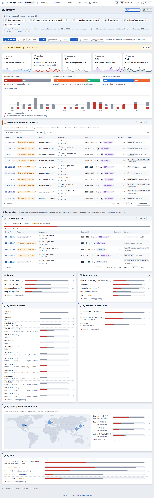
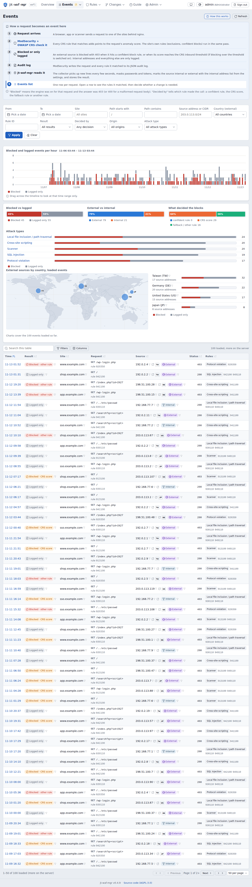
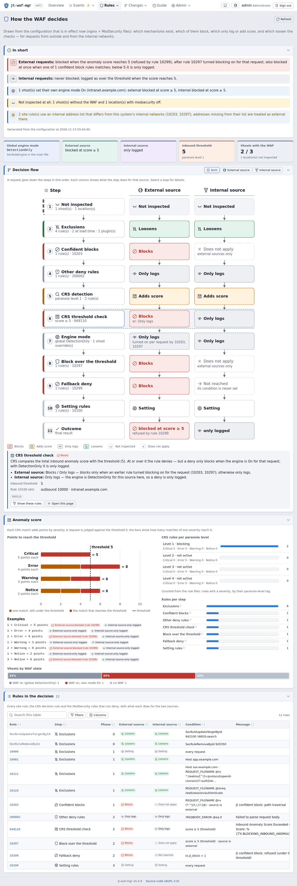
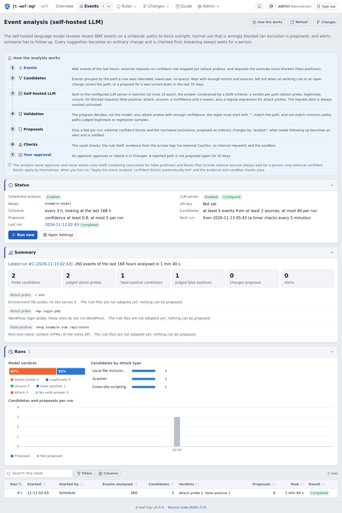
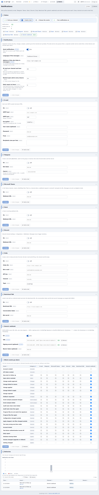
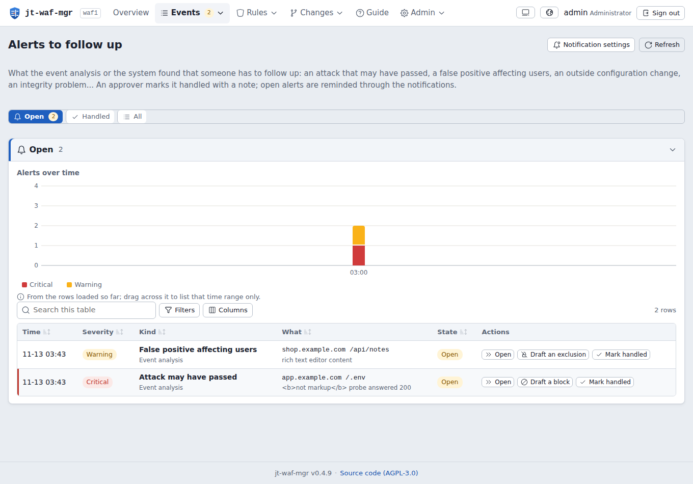
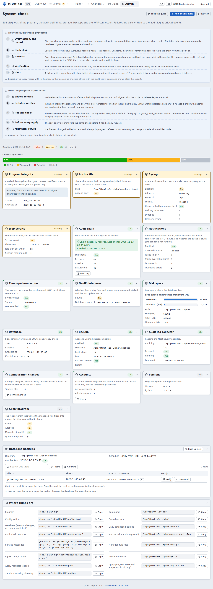

# jt-waf-mgr v0.4.9

**English** · [繁體中文](README_zh-TW.md) · [日本語](README_ja.md)

[](LICENSE)
[](https://github.com/jasoncheng7115/jt-waf-mgr/commits/main)


**🌐 [Project site →](https://jasoncheng7115.github.io/jt-waf-mgr/?lang=en)**

> A self-hosted web manager for **nginx + libmodsecurity v3 + OWASP CRS 4**: read what the WAF did, tune it through
> an evidence-checked, sandbox-tested and approved change workflow, let a self-hosted LLM review the events, and get
> notified on Teams, Telegram, Zulip, Slack, Discord, Nextcloud Talk, e-mail or a signed webhook.
>
> By Jason Tools Co., Ltd. · License: AGPL-3.0



---

## Why jt-waf-mgr?

libmodsecurity v3 has no management interface. Rules, exclusions and blocks are configuration files; tuning means
reading JSON audit logs and editing files by hand on a production reverse proxy. jt-waf-mgr turns the audit log into
something you can read, and every change into a workflow you can trust:

- **See what happened**: blocked / logged, by site, attack type, source (with country and network owner), rule and
  time; "blocked only by the CRS score" first, because those are the likely false positives.
- **Change safely**: templates (exclusion, confident block, redaction, plugin toggle, expert raw rule) → static checks
  (regex sanity, ReDoS) → evidence from the access logs → a throwaway nginx sandbox with the production configuration
  and regression samples → approval → a small root program that tests, reloads, health-checks and restores on failure →
  versions with one-click rollback.
- **Let a model help, never decide alone**: a scheduled analysis with your own OpenAI-compatible LLM server proposes
  narrow blocks for probes, the narrowest exclusion for false positives, and raises alerts — everything is validated by
  the program, loosening always needs a person.
- **Trust the trail**: hash-chained, append-only audit trail anchored outside the database and in syslog; signed
  releases; fingerprints of every nginx / ModSecurity / CRS file; compliance views for ISO/IEC 27001:2022, Taiwan's
  Cyber Security Management Act and OWASP Top 10:2025.

## Features

- **Collector**: the ModSecurity JSON audit log (copytruncate and rename rotation, oversized and malformed records);
  passwords, tokens and other sensitive fields are masked **before** anything is stored.
- **Overview and events**: drag across the timeline to zoom in, or pick any range up to 31 days; filters stay in the
  URL; event detail with every matched rule; one click to draft an exclusion or a block.
- **WAF model**: how a request is decided on these sites (engine per site, scoring, thresholds, exclusions,
  confident blocks), drawn from the live configuration.
- **Rules**: every rule with where it comes from (OWASP CRS and its version, a CRS plugin, imported at adoption, a
  change by a person, an API token or the event analysis), hits per day, syntax-highlighted text.
- **Change workflow**: single changes or one bundle (one approval, one version, one reload), upload of rule files,
  evidence, sandbox, health URLs, approval rules (the proposer cannot approve; single-admin mode with a fresh one-time
  code for loosening), automatic tightening within strict limits, rollback.
- **Event analysis (self-hosted LLM)**: candidates grouped by the path a rule sees; one schema-constrained request per
  batch; the program, not the model, decides what is proposed (narrow anchored regex, never matching common paths,
  regression samples or paths the organisation itself uses; exclusions are one exact path, specific rules and
  request parts only, and need a one-time code to approve); summaries of every run.
- **Alerts to follow up**: an attack the site may have answered, users hit by a false positive, an attack in progress,
  outside configuration changes, integrity problems, failed applies or backups — open until an approver marks them
  handled with a note; reminded until then.
- **Notifications**: e-mail (SMTP, text + HTML), Telegram, Microsoft Teams (Workflows / Adaptive Card), Slack,
  Discord, Zulip, Nextcloud Talk and a generic webhook (HMAC-SHA256 signature); a matrix of events × channels; a test
  per channel; retries, rate limits and delivery records. Values from requests are never markup, links or mentions.
- **Accounts**: scrypt passwords, TOTP required for approver / admin, lockout, password policy with history and
  ageing, account expiry and review; API tokens with scopes and allowed source networks (tokens can propose, never
  approve).
- **Integrity and compliance**: system check page, compliance page, daily verified backups with download (one-time
  code), configuration change history with attribution (jt-waf-mgr, registered automation, or outside).
- **Interface**: English, 繁體中文 and 日本語; light and dark; phones and tablets; GeoIP (MaxMind GeoLite2, downloaded
  by its own sandboxed job) with a world map of where requests come from, drawn in the page (no map service).

| | |
|---|---|
|  |  |
|  |  |
|  |  |

## Requirements

- Debian 12 / 13 or Ubuntu 22.04 / 24.04, **Python 3.11 or newer — standard library only, no pip, no wheels**: the
  service installs offline.
- nginx with the ModSecurity-nginx connector, libmodsecurity 3.0.9+, OWASP CRS 4.x, `SecAuditLogFormat JSON`;
  rotate the audit log with `copytruncate` (libmodsecurity does not reopen it on reload).
- Optional: an OpenAI-compatible LLM server on your network (llama.cpp, vLLM, Ollama…) for the event analysis; a
  MaxMind account for GeoIP.

## Install

```sh
openssl dgst -sha256 -verify release-key.pem -signature jt-waf-mgr-0.4.9.tar.gz.sig jt-waf-mgr-0.4.9.tar.gz
tar xzf jt-waf-mgr-0.4.9.tar.gz && cd jt-waf-mgr-0.4.9
sudo ./install.sh                             # verifies every file and the release signature first
sudo jt-waf-mgr check                         # parses the nginx / ModSecurity configuration
sudo jt-waf-mgr user add alice --role admin   # prints a temporary password
```

Add the management vhost (`/etc/jt-waf-mgr/nginx-vhost.conf.example`: internal networks only, proxies to
`127.0.0.1:8095`), `nginx -t`, reload, sign in, change the password and set up TOTP. Operational settings (GeoIP,
LLM, analysis, notifications, networks, policy) are made in the web interface; `/etc/jt-waf-mgr/config.toml` only
holds what the program needs to start.

To let jt-waf-mgr change rules: arm the apply program (`sudo ./install.sh --enable-apply`), set the health check URLs,
and adopt the existing rule files under Rules → Managed rules (an admin approves the adoption like any change).
Nothing touches nginx before that.

### Upgrade

```sh
sudo ./upgrade.sh --check     # every check, nothing changed
sudo ./upgrade.sh             # backup, switch, checks; rolls back by itself on any failure
sudo ./upgrade.sh --rollback  # later, if needed: back to the version (and database) before the upgrade
sudo jt-waf-mgr doctor        # health summary at any time
```

The upgrade verifies the new release with the installed program and the pinned key, refuses while a change is being
applied, keeps a backup in `/var/backups/jt-waf-mgr/` and records every upgrade (and every rollback) in the audit
trail. `./uninstall.sh` removes the program and keeps data and configuration (`--purge` removes them too).

## Security (OWASP Top 10:2025)

See [SECURITY.md](SECURITY.md) and [docs/COMPLIANCE.md](docs/COMPLIANCE.md). Please report vulnerabilities privately.

- The web service listens on loopback, runs unprivileged and never connects out; only the apply program runs as root.
  It re-validates every request (allowed directives only, checksums, no manual edits on disk) and writes only the
  managed files. GeoIP downloads, the LLM analysis and notifications each run in their own sandboxed one-shot unit.
- Strict CSP without `unsafe-inline`; everything that comes from a request (URLs, user agents, matched data, the
  model's text) is rendered as text.
- Sensitive values are masked before they reach the database; secrets in settings are write-only.
- A01: roles viewer / operator / approver / admin, API token scopes and source networks; tokens never approve.
- A04 / A07: scrypt, TOTP with replay protection, lockout, one-time codes for sensitive actions (limited attempts).
- A08: signed release manifest checked by the installer, the service and the apply program; hash-chained audit trail.
- A09: every write is audited, also to syslog (one JSON line, control characters escaped).
- Every release passes a test plan ([TEST_PLAN.md](TEST_PLAN.md)): unit tests, a browser test of every page, a security
  scan of every route, an OWASP ZAP active scan, an independent review, upgrade and rollback tests.

## Stack

| Layer | Choice |
|------|--------|
| Backend | Python 3.11+ standard library (http.server, sqlite3, hashlib.scrypt, tomllib, urllib, smtplib) |
| Database | SQLite (WAL), append-only audit table with triggers |
| Frontend | Vue 3 · Vite · own i18n (no runtime compilation, CSP-friendly) · Iconoir icons |
| WAF | nginx · libmodsecurity v3 · ModSecurity-nginx · OWASP CRS 4 |
| Deploy | systemd units (service, apply, GeoIP, analysis, notifications); no Docker needed |

## Project layout

```
jt-waf-mgr/
├── jtwafmgr/            # the program (collector, web API, change workflow, apply, analysis, notifications, integrity)
│   ├── collector/       # ModSecurity audit log reader
│   ├── web/             # HTTP server, routes
│   └── static/          # the built web interface
├── frontend/            # Vue 3 source of the web interface
├── deploy/              # systemd units, nginx example, release key, Wazuh rule drafts, ZAP baseline
├── docs/                # spec, API contracts, compliance mapping, project site
├── tests/               # unit and integration tests (synthetic data only)
├── tools/               # build, release, preflight, browser test, security scan, ZAP scan
├── install.sh · upgrade.sh · uninstall.sh
└── TEST_PLAN.md · TEST_CHECKLIST.md · SECURITY.md · CHANGELOG.md
```

## License

AGPL-3.0. If you run a modified version as a network service, offer its source to its users (the footer link does
that for the unmodified version).
