# jt-waf-mgr v0.5.54

[English](README.md) · [繁體中文](README_zh-TW.md) · **日本語**

[](LICENSE)
[](https://github.com/jasoncheng7115/jt-waf-mgr/commits/main)


**🌐 [プロジェクトサイト →](https://jasoncheng7115.github.io/jt-waf-mgr/?lang=ja)**

> **nginx + libmodsecurity v3 + OWASP CRS 4** のためのセルフホスト型 Web 管理ツールです。WAF が何をしたかを読み取り、
> 証拠の確認・サンドボックス試験・承認を経る変更フローでルールを調整し、オンプレミスの LLM にイベントを確認させ、重要な
> 事柄を Teams、Telegram、Zulip、Slack、Discord、Nextcloud Talk、メール、署名付き webhook に通知します。
>
> Jason Tools Co., Ltd. · ライセンス：AGPL-3.0

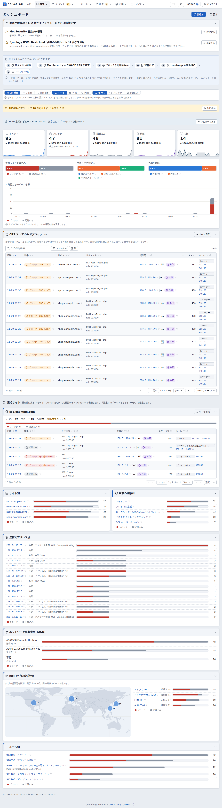

---

## なぜ jt-waf-mgr？

libmodsecurity v3 には管理画面がありません。ルール、除外、ブロックはすべて設定ファイルで、調整には本番のリバースプロキシ上で
JSON 監査ログを読み、ファイルを手で編集する必要があります。jt-waf-mgr は監査ログを読める画面にし、すべての変更を信頼できる
フローにします。

- **何が起きたかが分かる**：ブロック / 記録のみを、サイト、攻撃の種類、送信元（国とネットワーク事業者を含む）、ルール、時間
  ごとに表示。「CRS スコアだけでブロック」されたものを先頭に表示します（誤検知の可能性が最も高いため）。
- **安全に変更する**：テンプレート（除外、確定ブロック、マスク、プラグイン切替、エキスパート用の生ルール）→ 静的検査（正規表現、
  ReDoS）→ アクセスログからの証拠 → 本番設定と回帰サンプルによる使い捨ての nginx サンドボックス → 承認 → 小さな root
  プログラムが試験・reload・ヘルスチェックを行い、失敗時は自動で元に戻す → バージョンはワンクリックでロールバック。
- **モデルは手伝うが、単独では決めない**：自前の OpenAI 互換 LLM サーバーによる定期分析が、探査に対する狭いブロック、誤検知に
  対する最小の除外を提案し、アラートを出します。すべてプログラムが検証し、緩和は必ず人が承認します。
- **記録を信頼できる**：ハッシュチェーンの追記専用監査記録（アンカーはデータベース外と syslog）、署名付きリリース、すべての
  nginx / ModSecurity / CRS ファイルの指紋、ISO/IEC 27001:2022・台湾の資通安全管理法・OWASP Top 10:2025 との対照。

## 3 つの使い方


1. **nginx が Web サーバー**：サイトは nginx ホスト上にあります (静的ファイル、PHP-FPM など)。nginx が応答する前に
   ModSecurity が各リクエストを検査し、jt-waf-mgr がルール、承認、分析を管理します。
2. **nginx がリバースプロキシ**：サイトは別のサーバーにあり、ModSecurity を組み込んだ nginx が前段で WAF として保護し、
   検査を通過したリクエストだけを転送します。
3. **両方を 1 台で**：同じ nginx で一部のサイトはローカル、一部は別のサーバーへプロキシします。すべて同じ WAF、同じルール、
   同じ画面で管理し、WAF はサイトごとに有効にできます。

どの場合も jt-waf-mgr は nginx ホスト上で WAF の横に置かれます。リクエストは jt-waf-mgr を通らず、停止しても nginx と
ModSecurity は最後のルールのまま動作し続けます。

リバースプロキシーの nginx 設定例 (一般の Web サイト、WebSocket、Synology DSM、QNAP QTS と、各設定の理由)：[リバースプロキシーの設定例](https://jasoncheng7115.github.io/jt-waf-mgr/proxy.html?lang=ja)。

## 向いている場面・向いていない場面

jt-waf-mgr はリクエストの経路にありません。各リクエストは jt-waf-mgr がない場合と同じく nginx と ModSecurity、CRS が検査し、jt-waf-mgr が停止しても WAF は最後のルールで動き続けます。jt-waf-mgr が加える処理は同じホストの nginx の横で動き、制約もそこにあります。

**向いている**
- libmodsecurity v3 を使う 1 台の nginx ホスト (Web サーバー、リバースプロキシ、またはその両方) で、少人数のチームが WAF の変更をすべて検査・承認し、追跡と監査ができるようにしたい場合 (ISO/IEC 27001、台湾の資通安全管理法)。
- 証拠チェックが読む範囲のアクセスログが約 900 万行まで (毎秒約 1 万行を読み、15 分で打ち切り)。本番：数十サイト、1 日約 15 万リクエスト、730 万行。
- WAF イベント：収集プログラムは CPU 1 コアで毎秒約 750 件を保存できます (合成ログで計測)。通常のサイトの量を大きく上回り、攻撃の洪水で繰り返されるイベントはまとめます。

**現時点では向いていない**
- ロードバランサーの後ろの**複数の nginx に分かれたサイト** (大規模・高トラフィックのサイトによくある構成)：現在は単一ノードのみです (複数ノード管理は一時停止中)。
- **非常に大量のログ** (1 日数千万リクエストを数週間保持)：変更の証拠チェックが読み終わる前に止まり、完全な証拠なしで人が理由を説明する必要があります。
- 他のプロキシやエンジン (Apache、HAProxy、Envoy、Traefik、ModSecurity v2、Coraza)。
- 完全自動の WAF：ルールの緩和には必ず人の承認が必要です。

大規模サイトでは、ModSecurity と CRS のリクエストごとの負荷 (jt-waf-mgr の有無にかかわらず同じ) を自分のトラフィックで事前に計測してください。CDN やクラウド WAF という選択肢もあります。

## 機能

- **収集**：ModSecurity JSON 監査ログ（copytruncate と名前変更によるローテーション、過大・破損レコードに対応）。パスワードや
  トークンなどの機密項目は**保存前に**マスクします。
- **概要とイベント**：タイムラインをドラッグして拡大、または最長 31 日の期間を指定。絞り込み条件は URL に保持。イベント詳細で
  一致したすべてのルールを表示し、ワンクリックで除外やブロックを起案。
- **作戦室** (0.4.56 で追加)：概要 → 作戦室 で壁面スクリーン向けのボードを新しいタブに表示：直近 30 分 (または最長 7 日までの範囲、模擬攻撃のデモモードもあり) の平面地図と
  3D 地球 (送信元の国、ブロック/記録のみ、新しいイベントが WAF へ飛ぶ軌跡)、ブロック判定の流れ、サイトの活動 (2 分ごと)、誤検知の確認、AI 分析と脅威インテリジェンス、アラートと変更、巡回表示。アドレス・パス・クエリは表示しません。
- **一時的な IP ブロック**（0.4.24 で追加、任意）：メールサーバーの fail2ban、SOAR プレイブック、承認者が単一アドレスを
  一時的にブロックします。1 つの nginx deny リストがすべてのサイトに効きます。[一時的な IP ブロック](#一時的な-ip-ブロック任意)を参照。
- **国別ブロック**（0.4.28 で追加、任意）：サイトを一部の国だけに限定、または一部の国をブロックします。一覧は 5 つの地域
  インターネットレジストリから毎日更新。サイトごとの制限は変更フローを通るルールです。
  「ルール → 国別制限」に各サイトの許可国とブロック数が表示され、「変更」「制限を追加」ができます。[国別ブロック](#国別ブロック任意)を参照。
- **リクエスト量**（0.4.23 で追加）：nginx のアクセスログにあるすべてのリクエストを、サイトと時間ごとに集計します（2xx、
  3xx、4xx、5xx、403、444、429、外部、バイト数。数値のみで、IP・URL・User-Agent は保存しません）。WAF がブロックした数と
  並べて表示し、WAF の数字に分母を与えます。管理の「設定」→「リクエスト量」で有効・無効とアラートを設定します。任意の
  アラート（既定はオフ）：トラフィックの急増（そのサイトの過去 7 日間の同じ時間帯の通常量の N 倍）、または 5xx 応答の多発。
- **WAF 判定フロー**：現在の設定から、これらのサイトでリクエストがどう判定されるか（サイトごとのエンジン、スコア、しきい値、
  除外、確定ブロック）を図示。
- **ルール**：各ルールの出所（OWASP CRS とバージョン、CRS プラグイン、取り込み時のインポート、人・API トークン・イベント分析
  による変更）、日ごとのヒット数、シンタックスハイライト。0.4.23 で「作成元」を追加（絞り込みと作成元ごとの件数付き）：
  OWASP CRS、OWASP CRS プラグイン、サードパーティのプラグイン、ModSecurity 基本設定、jt-rules（jt-waf-mgr がフォームから
  生成するルールと jt-rules のルールパック）、サイト独自（手書きのルール：取り込み時にインポートしたもの、raw ルール、
  nginx の vhost ファイル）。
- **変更フロー**：単独の変更または一括（1 回の承認・1 バージョン・1 回の reload）、ルールファイルのアップロード、証拠、
  サンドボックス、ヘルスチェック URL、承認ルール（提案者は承認不可。シングル管理者モードで自分の緩和を承認するにはワンタイム
  コードを再入力）、厳しい条件付きの自動強化、ロールバック。
- **1 層目の LLM (イベント分析、オンプレミス)**：ルールが見るパスで候補をまとめ、バッチごとに JSON スキーマで形式を制約したリクエストを
  送信。提案内容はモデルではなくプログラムが決めます（アンカー付きの狭い正規表現で、一般的なパス・回帰サンプル・組織自身が
  使うパスには一致しない。除外は一つの完全一致パスと特定のルール・項目のみで、承認にはワンタイムコードが必要）。外部から
  機密・バックアップ・設定のファイル名を探る要求や、同じアドレスが多くのパスを試す要求はプログラム自身の規則で偵察と判定し、
  以前に攻撃と判定したパスは一度の「誤検知」判定では緩和しません。実行ごとの要約。
  **AI はどちらの方向にも誤ることがあります**：モデルは提案するだけで、緩和は必ず人が承認し、すべてのチェックに合格した
  強化だけが自動適用されます。使う LLM については[イベント分析：推奨する LLM](#イベント分析推奨する-llm) を参照してください。
- **単一イベントの AI 分析**:各イベントのボタンで、イベントと周辺情報(同じ送信元の 1 時間・30 日間の行動、同じサイト・パスの
  7 日間、一致したルール)をローカル LLM に送り、攻撃・誤検知・不明の判断と理由、対応(アドレスのブロック、リクエストの
  ブロック、最小限の除外、様子見)を示します。ボタンは通常のフォームを開くだけで、ブロックと除外はいつもどおり確認・承認します。
- **WAF 定期レビュー**:3 時間ごと(保存し、通知チャネルに送信):CRS スコアのみでブロックしたリクエスト(誤ブロックの可能性を
  先頭に)、新しい内部の一致、通過した外部攻撃、自動処理の内容、重点サイトごとの 1 行。
- **2 層目の LLM (脅威インテリジェンス)**:より強力な LLM(ローカルの OpenAI 互換、またはクラウドの OpenAI 互換 / Anthropic / Google Gemini)が
  数時間ごとに、プログラムが推測し人が確認した Web アプリケーション一覧 (このホストの Web 関連パッケージ約 50 種、CRS、応答するパスやトップページの特徴から判別するサイトのアプリケーション約 300 種)の新しい
  脆弱性、特に悪用されているものを Web で検索します。このホストから出るのは製品名とバージョン、それに脆弱性の前提条件を判断するためのホスト情報 (OS、アーキテクチャ、C ライブラリ) だけです。ローカルモデルは MCP
  サーバー(例:SearXNG)で検索します。Anthropic と OpenAI 公式 API はプロバイダー自身の Web 検索も使えます。プログラムは
  許可リストの https ページだけを読み、「悪用中」はその実行でプログラム自身が CISA カタログを読んだとき、または KEV カタログ (毎日取得、約 1.5 MB) をオンにしてそこに載っているときだけ認めます。
  製品は名前だけでも確認できます。悪用されていて当方のバージョンに影響する脆弱性は
  緊急アラートになります。インストール済みの Debian パッケージは自身の変更履歴と照合し、任意で Debian セキュリティトラッカーにも問い合わせます (導入済みのバージョンで修正済み、影響なし、別のプログラムの CVE なら対象外、新しいパッケージで修正済みなら更新を促します)。Synology 製品 (DSM やパッケージ) や QNAP 製品 (QTS、QuTS hero、アプリ) があるときは、任意でそのベンダー公式のセキュリティアドバイザリ (RSS) を毎日読み、最近数か月の分をモデルに渡して影響を受けるバージョンと修正バージョンを照合します。任意でバックエンドホストのバージョンも読み取れます：nginx はバックエンドの Server ヘッダーを転送しないため、proxy_pass が指すプライベートアドレスの応答ヘッダーを直接読み、バックエンドの nginx、Apache、PHP のバージョンをソフトウェア一覧に載せ、バックエンドの nginx が nginx.org の公告に該当すれば警告します。URL、ヘッダー、パラメーター名(クエリ文字列、フォーム、アップロード)で判別できるものには、脆弱性ごとに影響するすべてのサイトを対象とする仮想パッチ(狭い確定ブロック。通常の変更と同じく、アクセスログで確認できるものは証拠を、常に
  サンドボックスを確認)を作成し、確認に通れば人の承認なしで 1 日の上限内で適用します。悪用されていて影響するものは上限を受けず、確認に失敗すれば緊急アラートで
  人の判断を求めます。プログラムは毎回、各製品とその基盤の言語・フレームワークを自ら検索します(PHP の脆弱性はすべての PHP アプリケーションに及びます)。予告されたセキュリティリリースはアラートになり、公開後に自動で再検索します。ページやテキスト(ニュース記事、ベンダーの勧告)を渡してすぐ分析させることもできます。1 日・1 か月のトークン上限があり、1 回の実行は 45 分以内です。
- **IP レピュテーション**:IP 照会で、このサイトが見た証拠と、毎日ダウンロードする公開リスト(Spamhaus DROP、FireHOL level 1、abuse.ch Feodo、Emerging Threats、CINS Army、blocklist.de、Tor の出口ノード。ホスト上で照合)、Shodan InternetDB、自組織の MISP をまとめて、判定とその根拠を示します。デフォルトは無効で、自動ではブロックしません。
- **CrowdSec 仮想パッチルール**:CrowdSec Hub の appsec ルール(MIT ライセンス)を毎日同期し(オフラインでのアップロードも可)、ホスト上で ModSecurity ルールに変換します。すべての条件の意味を保てるルールだけを変換します。
  変換したルールはそのソフトウェアを動かすサイトに、アプリ横断の脆弱性(React、Spring、PHP などのフレームワーク、ライブラリ、言語。サイトのソフトウェアが使う技術で関係を判断)ならすべてのサイトにも、通常の変更として提案でき、サンドボックスが上流の攻撃リクエストを再送して、すべてこのルールで遮断され、サイトの最近のリクエストは遮断されないことを確認します。
  適用中のルールは上流で更新・削除されると表示されます。確認済みソフトウェアに影響する脆弱性では、脅威インテリジェンスが上流のルールを優先して提案します。
- **アプリケーション保護セット**：1 つのアプリケーション向けに、公開済みの脆弱性と実際の攻撃をもとに用意した確定遮断ルール。最初のセットは Synology DSM(管理 API をローカルネットワークだけに限定。一括リクエストやエスケープ文字による回避も含む)。2 番目は QNAP QTS (セットアップウィザード、HBS 3 の組み込みセッション ID、ファイル名の ../、長すぎる ID、ユーザー名とセッション Cookie のシェル文字。公開情報から作成し、QNAP 実機では未検証)。さらに Nextcloud (非公開のファイルとディレクトリ、送られたパスの ../、内蔵 CODE サーバーのコマンド注入 CVE-2026-110447、外部からのアップデーターとアップグレード) と Zimbra (ユーザーポートの管理サービス、1 つの GraphQL リクエストでの複数ログイン、ログイン名の LDAP ワイルドカード、パラメーターで送る内部 servlet 属性、/h/rest、識別子パラメーターの HTML)、LibreNMS (外部からの管理ページ、パラメーターで送る API トークン、通知・アドレス・並べ替え・パッケージのパラメーターの SQL、デバイスのホスト名のシェル文字、グラフのパラメーターの引用符と改行)。各セットのリクエストは実際の nginx＋ModSecurity 3.0.9 と 3.0.17＋CRS 4.30 のサンドボックスで再送して確認しています。ソフトウェア一覧は DSM サイトとそのパッケージを認識します(DSM はログインなしで提供する API を一覧にします)。サイトとルールを選んで 1 件の変更として提案すると、通常のチェック、各ルールの攻撃リクエストと通常のリクエストのサンドボックス再送を経て、人が承認します。ほとんどのルールは外部からのリクエストだけを拒否します。
- **対応待ちアラート**：防がれていない可能性のある攻撃、利用者に影響する誤検知、進行中の攻撃、設定の外部変更、完全性の問題、
  適用やバックアップの失敗。承認者が対応内容を記入するまで開いたままで、定期的に再通知します。
- **通知**：メール（SMTP、テキスト＋HTML）、Telegram、Microsoft Teams（Workflows / Adaptive Card）、Slack、Discord、Zulip、
  Nextcloud Talk、汎用 webhook（HMAC-SHA256 署名）。イベント × チャネルのマトリクス、チャネルごとのテスト送信、再送・上限・
  送信記録。メッセージに引用するリクエストの内容 (URL、ヘッダーなど) はプレーンテキストとして送るため、攻撃者がリンク、書式、@ メンションを紛れ込ませることはできません。
- **OWASP CRS の更新**（任意、既定はオフ）：制限付きの毎日の確認で、使用中のメジャーバージョンの最新リリースを公開から 1 週間後に
  取得し、固定した CRS リリース鍵による有効な署名があるものだけを保管します。CRS ページで使用中・最新・検証済みのバージョンを表示します。
  切り替え（または保持している旧バージョンへの戻し）は変更として扱い、両バージョンにサンドボックスで同じ最近の要求を通して比較し、人が承認し、
  root プログラムが署名を再検証して自ら展開し、crs リンクを切り替え、失敗すれば元に戻します。ロールバック用に 3 バージョンを
  保持します。CRS のないホストも同じ流れで CRS 4 をインストールできます（Include は modsecurity.conf の直後に追加）。
- **nginx の更新と nginx 自体の欠陥**（0.4.98 で追加）：6 時間ごとに次の nginx を ModSecurity モジュールで試し（更新で WAF
  が外れないように）、nginx.org のセキュリティアドバイザリをインストール済みの nginx とこの設定で使う機能に照らします。nginx 自体の
  欠陥（HTTP/2、HTTP/3、resolver など）は ModSecurity がリクエストを見る前に起きるため、警告は更新を促します。検証済みの更新は管理者
  の承認用に提案され、HTTP/2 や HTTP/3 を一時的に止めることもできます（重大なアドバイザリでは自動で止め、更新後に戻す。印付きで
  元どおりに戻せる変更）。0.5.1 からは承認前に戻し方を示します：以前のパッケージとモジュールを保管し、「以前の nginx に戻す」
  「別のモジュールを使う」は通常の変更として承認します（nginx が止まり管理画面に入れないときもコマンドで操作可能）。設定と
  モジュールのバックアップを先にダウンロードでき、管理者は「nginx のセキュリティ更新を自動適用」を有効にできます（既定は無効）。
  [更新後に nginx が戻らないとき](docs/RECOVERY.ja.md) を参照してください。
- **ログサーバー（syslog / SIEM）**：最大 8 か所。それぞれプロトコル（ローカルソケット、UDP、TCP、TLS）、メッセージ形式（JSON、
  CEF、LEEF 2.0、GELF 1.1、key=value）、送信内容（監査記録、WAF イベント、アラート）を選べ、キューと再送も個別。テスト送信で
  実際に送った内容を表示します。
- **アカウント**：scrypt パスワード、approver / admin は二要素認証必須、ロックアウト、履歴と期限付きのパスワードポリシー、
  アカウントの期限と見直し。API トークンはスコープと許可送信元ネットワーク付き（提案はできるが承認は不可）。ホスト上での
  復旧は[アカウントと復旧](#アカウントと復旧)を参照してください。
- **完全性とコンプライアンス**：システムチェック、コンプライアンス、毎日検証されるバックアップとダウンロード（ワンタイム
  コード）、設定変更の履歴と原因判定（jt-waf-mgr、登録済みの自動化、外部）。外部による変更では各ファイルの変更内容
  （機密らしい値は伏せる）と、その間にホストへログインしていたユーザーを表示します。
- **画面**：English・繁體中文・日本語、ライト / ダーク、スマートフォンとタブレット、GeoIP（MaxMind GeoLite2、専用の制限付き
  ジョブでダウンロード）と、ページ内で描画するリクエスト発信元の世界地図（地図サービスは使いません）。

| | |
|---|---|
| 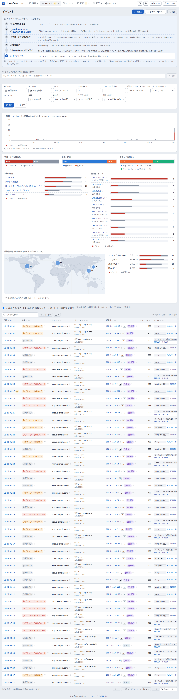 | 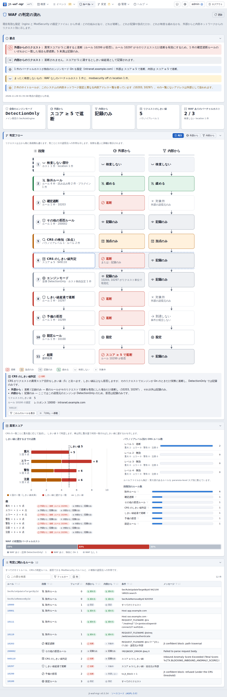 |
| 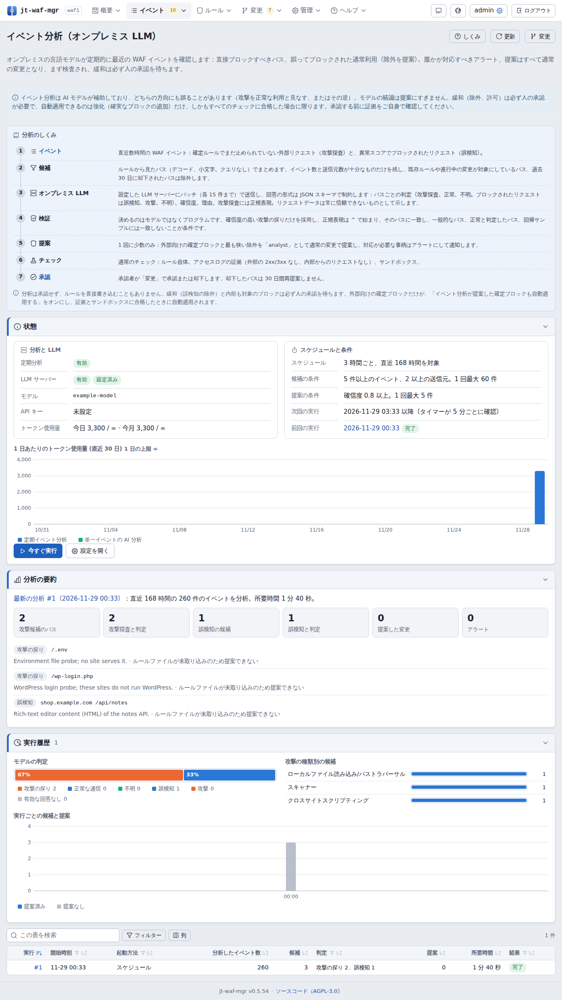 | 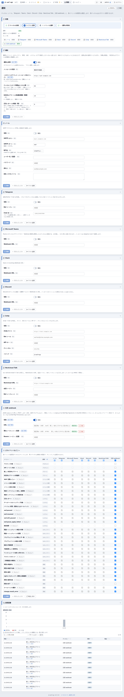 |
| 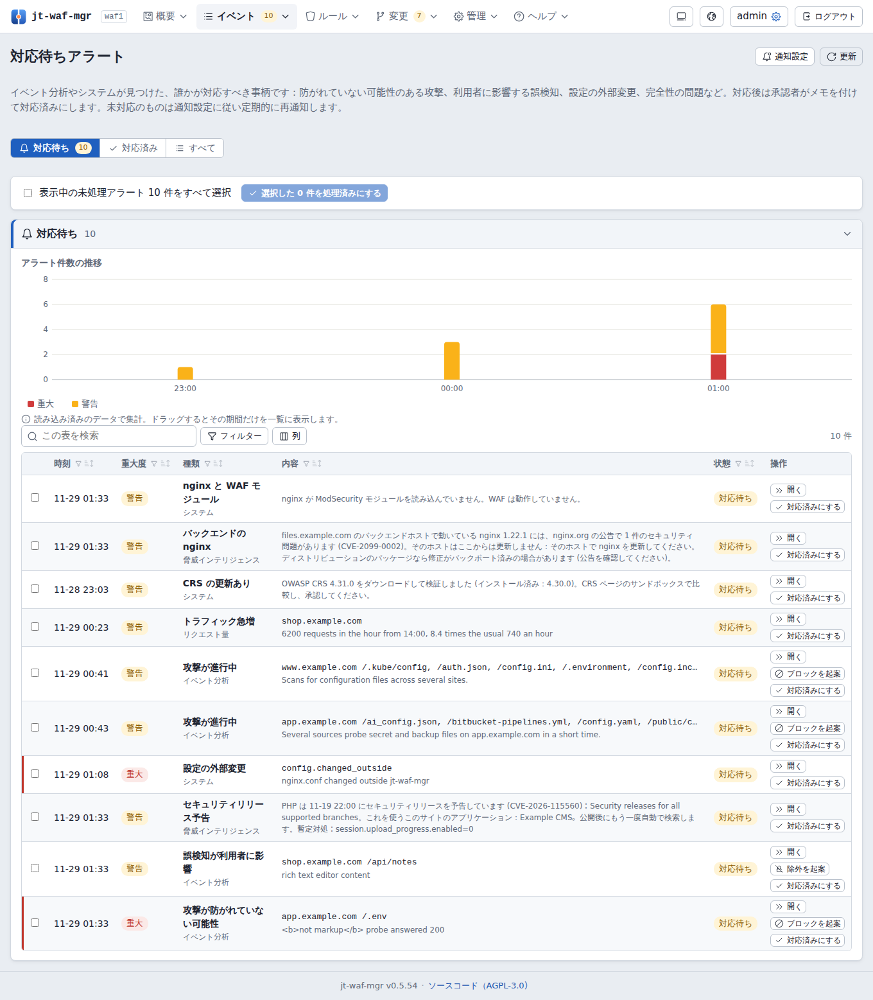 | 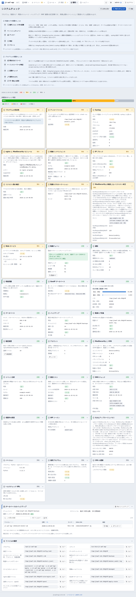 |
| 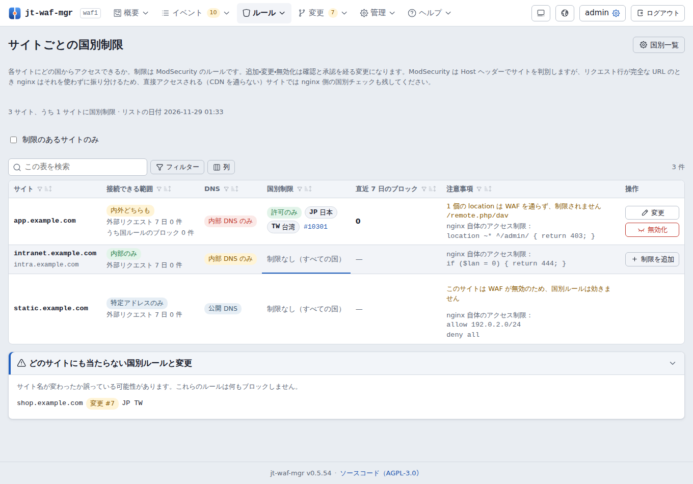 | 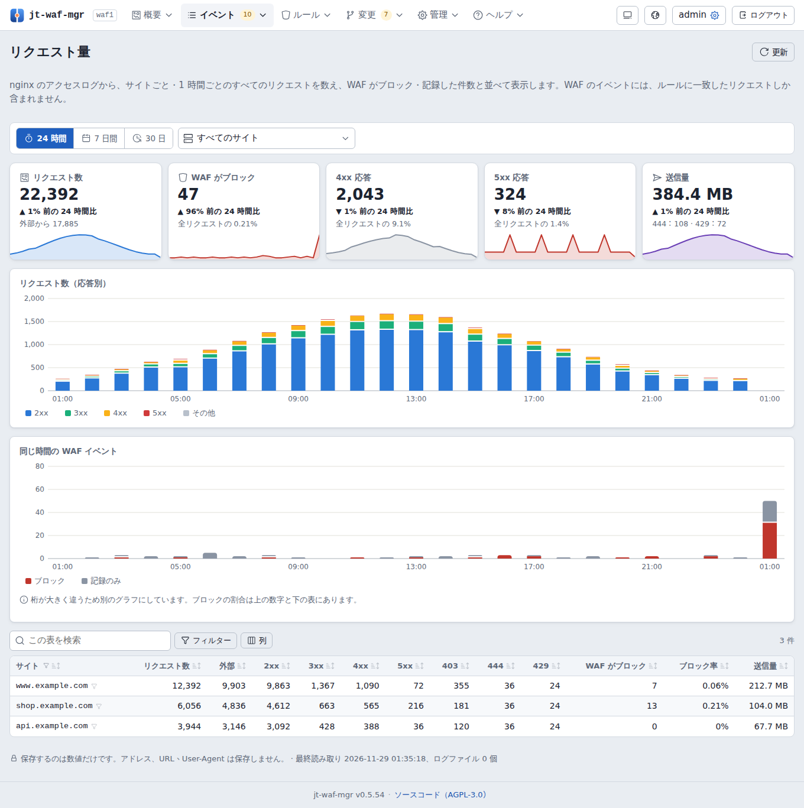 |
| 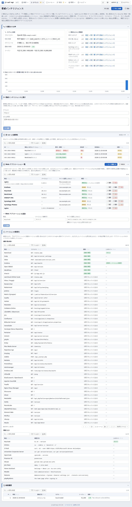 | 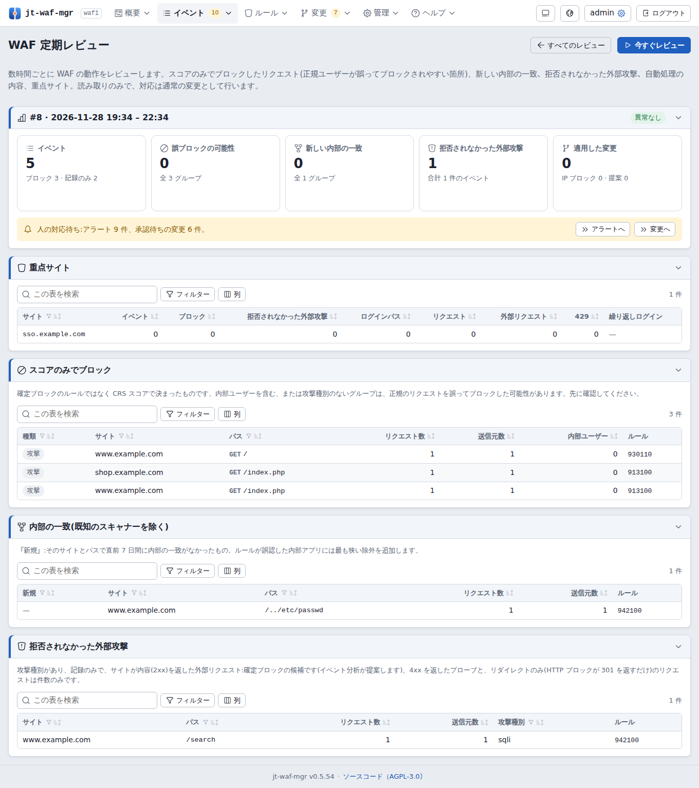 |

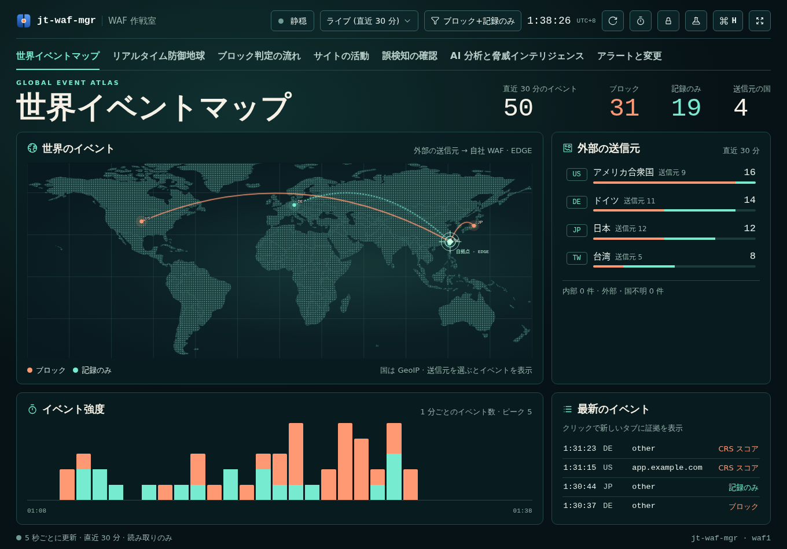

## 要件

- Debian 12 / 13 または Ubuntu 24.04 以降（22.04 の libmodsecurity パッケージは古いため 3.0.9 以上を自分でビルド）、**Python 3.11 以上（標準ライブラリのみ、pip もパッケージも不要）**：オフラインで
  インストールできます。
- nginx と ModSecurity-nginx コネクタ、libmodsecurity 3.0.9 以上、`SecAuditLogFormat JSON`。OWASP CRS 4.x は jt-waf-mgr が
  ダウンロード・検証・インストールできます（[OWASP CRS](#owasp-crs) を参照）。監査ログは
  `copytruncate` でローテーションしてください（libmodsecurity は reload 時にファイルを開き直しません）。nginx を新しく入れる
  場合や CRS 4 がない場合は [ModSecurity インストールガイド](docs/MODSECURITY.ja.md)、インターネットに接続できないホストは
  [オフラインでのインストールと更新](docs/OFFLINE.ja.md) を参照してください。サイトのルール
  ファイルがなくても取り込めます（CRS ルールの前後に空の管理ファイルを追加します）。
- 任意：イベント分析用のネットワーク上の OpenAI 互換オンプレミス LLM サーバー（llama.cpp、vLLM、Ollama など。
  [推奨する LLM](#イベント分析推奨する-llm) を参照）、GeoIP 用の MaxMind アカウント。

## インストール

```sh
sudo mkdir -p /opt/jt-waf-mgr-install && cd /opt/jt-waf-mgr-install   # リリースの決まった場所
V=0.5.54; B=https://github.com/jasoncheng7115/jt-waf-mgr/releases/download/v$V
for f in jt-waf-mgr-$V.tar.gz jt-waf-mgr-$V.tar.gz.sig release-key.pem; do sudo curl -fsSLO $B/$f; done   # リリース、署名、公開鍵
openssl dgst -sha256 -verify release-key.pem -signature jt-waf-mgr-$V.tar.gz.sig jt-waf-mgr-$V.tar.gz
sudo rm -rf current && sudo mkdir current && sudo tar xzf jt-waf-mgr-$V.tar.gz -C current --strip-components=1 && cd current
sudo ./install.sh                             # 先にすべてのファイルとリリース署名を検証
sudo jt-waf-mgr check                         # nginx / ModSecurity 設定を解析
sudo jt-waf-mgr user add alice --role admin   # 一時パスワードを表示
```

インストール後の場所：

- プログラム `/usr/lib/jt-waf-mgr`、コマンド `/usr/bin/jt-waf-mgr` (root 所有、読み取り専用)
- 設定 `/etc/jt-waf-mgr`
- データ (データベース、キュー) `/var/lib/jt-waf-mgr`、適用プログラム `/var/lib/jt-waf-mgr-apply`
- アップグレード前のバックアップ `/var/backups/jt-waf-mgr`
- リリース `/opt/jt-waf-mgr-install`、現在のものは `/opt/jt-waf-mgr-install/current` に展開 (インストール・アップグレード・削除はここで実行)

### 管理画面への接続

サービスは `127.0.0.1:8095` だけで待ち受けます（`/etc/jt-waf-mgr/config.toml` の `[server] listen`）。直接公開することは
なく、nginx の管理用 vhost から転送します。リリースは vhost の例を `/etc/jt-waf-mgr/nginx-vhost.conf.example` に
インストールします。nginx の vhost ディレクトリにコピーしてください。例：

```sh
sudo cp /etc/jt-waf-mgr/nginx-vhost.conf.example /etc/nginx/sites-available/waf.example.com.conf
sudo ln -s /etc/nginx/sites-available/waf.example.com.conf /etc/nginx/sites-enabled/
# （または /etc/nginx/conf.d/waf.example.com.conf にコピー）
```

コピーしたファイルで次を設定します：

- `server_name`：開くときの名前（例：`waf.example.com`）。
- `ssl_certificate` と `ssl_certificate_key`：証明書（下記参照）。
- `allow` の行：内部ネットワークのみ（さらに絞るなら管理者のネットワーク）。それ以外は `deny all` のままにします。

続いて `sudo nginx -t && sudo systemctl reload nginx` を実行します。この vhost は意図的に `modsecurity off` にしています。
管理画面は攻撃文字列を表示するため、WAF を有効にすると自分自身で WAF に引っかかるからです。任意：例にあるコメントアウト
された `limit_req` ブロックで、サインインの前に総当たり攻撃への歯止めを追加できます。

証明書は次のいずれか：

- 組織内部の CA、または既存のワイルドカード証明書。
- Let's Encrypt：管理サイトは内部専用なので、HTTP-01 チャレンジは通常届きません。DNS-01 チャレンジ（certbot と DNS
  事業者のプラグイン）を使うか、公開ホストで発行してコピーしてください。
- 検証環境に限り、自己署名証明書（ブラウザに警告が出ます）：

```sh
sudo openssl req -x509 -newkey rsa:3072 -nodes -days 825 -keyout /etc/ssl/private/waf.key -out /etc/ssl/certs/waf.crt -subj "/CN=waf.example.com" -addext "subjectAltName=DNS:waf.example.com"
```

その後 `https://waf.example.com`（設定した名前）を開き、`jt-waf-mgr user add` が表示した一時パスワードでサインインします。
初回のサインインでは新しいパスワードと TOTP 二要素認証の設定が必須です。運用設定（GeoIP、LLM、分析、通知、リクエスト量、
ネットワーク、ポリシー）は Web 画面で行い、`/etc/jt-waf-mgr/config.toml` には起動に必要な項目だけを置きます。

### jt-waf-mgr にルールを変更させる

jt-waf-mgr が書き込むのは ModSecurity のファイルです。nginx の設定を読み（サイトと ModSecurity のメイン設定ファイルを
見つけるため）、`nginx -t` を実行し、nginx を reload します。管理用 vhost と nginx の `modsecurity on;` は、管理者自身が
一度だけ行う編集です。nginx 自体を変更するのは、承認された変更を root プログラムが行う場合だけで、毎回 `nginx -t`、
ヘルスチェック、失敗時の戻しを伴います：任意の一時 IP ブロックのリスト（`deny` 行だけのファイルをお客様が一度 include）、
サイトごとの印付き include 行（WAF のオン・オフ、ブロックページ）、nginx 自体に欠陥があるときの HTTP/2・HTTP/3 の一時停止
（印付きで元どおりに戻せる）、nginx パッケージと ModSecurity モジュールの更新と戻し。

jt-waf-mgr にルールを変更させるには、適用プログラムを有効にし（`sudo ./install.sh --enable-apply`）、ヘルスチェック URL を
設定し、「ルール → 管理対象ルール」で既存のルールファイルを取り込みます（通常の変更と同様に admin が承認）。それまでは何も
書き込みません。サイトのルールファイルがなくても取り込めます。

### サイトの WAF を有効にする

「サイト」ページは各 server ブロックと ModSecurity の有無を表示します。無効のサイトで承認者が「WAF を有効化」を押して理由を
書くと変更になります。確認ではアクセスログにあるそのサイトの最近の正常なリクエストを ModSecurity 有効の状態でサンドボックスで
再生し、拒否されるものを示します。人が承認すると、root の適用プログラムがサイトの `server {` の次の行に印付きの**1 行**——
`include <他のサイトが ModSecurity を有効にするスニペット>;  # jt-waf-mgr: WAF on (change #N)`——を追加し、`nginx -t`、reload、
ヘルスチェックを行い、失敗すればすべて元に戻します。「WAF を無効化」はその行だけを削除します(緩和として通常どおり承認)。
他の方法で有効にした WAF や、手書きの `modsecurity off;` があるブロックには触れません。書き込み前に root プログラムが計画を
自分で再計算し、承認された内容と一致しファイルが確認時のままのときだけ書き込みます。

### ブロックされた人に表示するページ

設定しない場合、ブロックされた人には nginx 標準の「403 Forbidden」が表示されます。**サイト**ページの「ブロックページ」で、
リクエスト ID(nginx の `$request_id`、SSI で表示)を示す 3 言語のページをすべてのサイトに一度に適用できます。表からサイトごとに
適用することもできます。人が承認する変更として行い、コンテンツを提供する各 server ブロックにマーク付きの include を 1 行追加
します(リダイレクトのみ、または独自の 403 ページを持つブロックは変更しません)。root プログラムがページとスニペットを管理対象の
ルールファイルの隣に書き込み、`nginx -t`、reload、ヘルスチェックを行い、失敗すればすべて元に戻します。
`modsecurity_transaction_id "$host-$request_id";` を設定していればイベントにも同じ ID があり、イベントページの
「ブロックされた?」に貼り付けるとそのイベントを開けます。WAF(国別ルールを含む)と IP ブロックリストの 403 で表示されます。
サイト独自の nginx `if` が先に返す 403 や、背後のアプリケーションの 403 ページには影響しません。スニペットとページは
jt-waf-mgr のものです。新しいリリースで新しい内容が届いたときは「ページを更新」で書き込みます(変更として)。「削除」で行を元に戻します。

### OWASP CRS

CRS は jt-waf-mgr が扱います。新しいホストに必要なのは、nginx と ModSecurity モジュール、`SecAuditLogFormat JSON` を含む
`modsecurity.conf`、`modsecurity.conf` を Include するメイン設定ファイル、nginx の `modsecurity on;` と
`modsecurity_rules_file …` だけです（[ModSecurity インストールガイド](docs/MODSECURITY.ja.md)）。その後：

1. CRS ページで「ここで CRS を最新に保つ」をオンにします。
2. jt-waf-mgr は最新の CRS 4.x を公開から `wait_days`（既定 7 日）経ってからダウンロードし、固定した CRS 署名鍵で検証します。
3. 「サンドボックスで比較してインストールを提案」で変更が作成されます。
4. 人が承認すると、jt-waf-mgr が `crs-<バージョン>`、`crs` リンク、`crs-setup.conf` をインストールし、`modsecurity.conf` の
   直後に Include を挿入します。
5. 続いて既存ルールの取り込みを行うと、CRS ルールの前後に jt-waf-mgr の管理ルールファイルが追加されます。

以後の CRS 更新も同じ流れです：ダウンロード、検証、サンドボックスでの比較、人による承認、インストール。ロールバック用に
3 バージョンを保持します。CRS を手動でインストールすることもできます（ガイドを参照）。

### 一時的な IP ブロック（任意）

他のシステム（たとえば Web メールがこのプロキシの後ろにあるメールサーバーの fail2ban）は、API（スコープ `blocks:write`）で
単一アドレスを一時的にブロックできます。承認者は「ブロック中の IP」ページで操作できます。jt-waf-mgr は一覧を `deny` 行
だけの nginx ファイル 1 つに書き込み、ModSecurity を使わないサイトも含めてすべてのサイトに効きます。使い方：

1. ファイルを作成し、nginx.conf の `http { }` の中で一度だけ include してから、テストして reload します：
   ```sh
   sudo install -D -m 644 /dev/null /etc/nginx/jt-waf-mgr/blocked-ips.conf
   # nginx.conf の http { } の中：   include /etc/nginx/jt-waf-mgr/blocked-ips.conf;
   sudo nginx -t && sudo systemctl reload nginx
   ```
2. 設定 → 一時的な IP ブロック：オンにし、決してブロックしないネットワーク（たとえばサイトの前の CDN）を登録します。
3. 管理 → API トークン：`blocks:write`（と `blocks:read`）を持ち、呼び出し元ホストのアドレスに限定したトークンを作ります。
4. 例：API でブロックと解除を行う fail2ban のアクション：
   ```ini
   # /etc/fail2ban/action.d/jt-waf-block.conf  (chmod 600: it holds the token)
   [Definition]
   actionban   = curl -fsS -m 10 -X POST -H "Authorization: Bearer <token>" -H "Content-Type: application/json" \
                 -d '{"ip": "<ip>", "ttl": <bantime>, "source": "<source>", "reason": "fail2ban <name>"}' <waf>/api/v1/blocks
   actionunban = curl -fsS -m 10 -X DELETE -H "Authorization: Bearer <token>" "<waf>/api/v1/blocks/<ip>?source=<source>"
   [Init]
   waf    = https://waf.example.com
   token  = jwm_...
   source = mail1/<name>
   ```
   jail では `action = jt-waf-block` を使います。`bantime` は 60 秒から 7 日の間にしてください（それより長い、または永久の
   ブロックは拒否されます）。内部アドレスは jail の `ignoreip` で除外したままにします（いずれにしても拒否されます）。
   任意で、設定 → 一時的な IP ブロック →「機密ファイルを探す送信元を自動でブロック」：1 時間以内に 5 つの異なる機密・設定ファイル名を
   要求した外部アドレスを、プログラムのルールで 24 時間ブロックします。WAF イベントを見て、拒否または見つからなかった（4xx/5xx）
   ファイル名だけを数え、少なくとも 1 つは明白な機密ファイル（.env、.git、鍵、ダンプ、バックアップ）であることが条件です。
   こうした名前に 2xx/3xx が返ったアドレスは自動でブロックせず、人の判断に任せます。変更フローを通らず全サイトでブロックするため、既定はオフです。

ブロックの既定は 24 時間、トークンからは最長 7 日、手動では最長 30 日です。承認者は延長でき、管理者は Web 画面で無期限に
できます（理由が必要。トークンやルールからは不可）。内部ネットワーク、
既知のスキャナー、信頼するプロキシ、保護リストは決してブロックされません。nginx は `real_ip` 後のアドレスで判定するため、
CDN の後ろのサイトには `set_real_ip_from` / `real_ip_header` が必要です。独自の `allow` / `deny` を持つ server と location は
このリストを継承しません（「ブロック中の IP」ページに表示）。ブロックは約 1 分以内に新しいリクエストに効きます。すでに開いている接続（WebSocket）は閉じるまで続きます。詳しくは [API マニュアル](docs/API.ja.md) の 4.9 節を参照してください。

### 国別ブロック（任意）

リクエストの送信元の国で個々のサイトを制限します。列挙した国だけを許可する（例：「台湾と日本のみ」）か、列挙した国を
ブロックします。各制限は ModSecurity のルールで、ほかのルールと同じく変更フロー（チェック、サンドボックス、承認、ロールバック）
を通ります。アドレス一覧はデータであり、更新は変更フローを通りません。

1. 設定 → 国別ブロック：オンにして「今すぐ更新」。別の制限付きジョブが 5 つのレジストリの delegated ファイル（APNIC、ARIN、
   RIPE NCC、LACNIC、AFRINIC、合計約 28 MB）をダウンロードし、各レジストリの MD5 ファイルとファイル自身の件数で検証して、
   5 つすべてが通ったときだけ一覧を置き換えます。以後は 1 日 1 回。Web サービス自体は外部に接続しません。
2. 変更 → 新規 → 国別ブロック：サイト、「これらの国のみ許可」または「これらの国をブロック」、国を選びます。チェックはアクセス
   ログから、このルールがブロックしたはずのリクエスト数とアドレス数、そのうち 2xx/3xx で応答されたもの（締め出される実際の
   利用者）を数えます。サンドボックスは許可される国、ブロックされる国、内部からのリクエストを 1 つずつテストします。
3. 承認後、root の適用プログラムがルールの読む一覧（`/etc/nginx/modsec/jt-waf-mgr/countries/`）を書き、nginx をテストして reload します。

決してブロックしないもの：内部ネットワーク、既知のスキャナー、信頼するプロキシ、保護リスト（設定 → 一時的な IP ブロック）。
サイトの前にある CDN が締め出されることはありません。CDN の後ろのサイトには `set_real_ip_from` / `real_ip_header` が必要です。
ルールは ModSecurity で動くため、`modsecurity off` の location は対象外です。レジストリのデータはアドレスブロックの登録国であり、
利用者の実際の所在地ではありません（VPN、クラウドのリージョン、ローミング中の携帯は別の場所のことがあります）。

### アカウントと復旧

ホスト上で root として実行します：

```sh
sudo jt-waf-mgr user list                       # アカウント、ロール、状態（disabled、totp、must-change）
sudo jt-waf-mgr user add alice --role approver  # ロール：viewer（既定）、operator、approver、admin
sudo jt-waf-mgr user unlock alice
sudo jt-waf-mgr user reset alice
sudo jt-waf-mgr user passwd alice
sudo jt-waf-mgr user disable alice              # および enable
```

- `add`：一時パスワードを表示します。初回サインインで変更が必要です。
- `unlock`：サインイン失敗によるロックを解除します。
- `reset`：新しい一時パスワードを発行し、TOTP を消去し、サインイン時にパスワード変更を強制します。スマートフォンを
  なくしたときの復旧方法です。
- `passwd`：対話形式でパスワードを設定します。
- `disable` と `enable`：アカウントを無効化・再度有効化します。
- これらの変更はすべて監査記録に残ります。

### コマンドラインでの管理

Web 画面の IP ブロック、アラート、変更、設定、API トークン、脅威インテリジェンスの操作はコマンドでもできます (同じルール)。書き込みは誰のために行うかを `--as` で指定します (Web 画面と同じロールを持つ既存アカウント)。監査記録にはその人と送信元 `cli` が残ります。

```sh
sudo jt-waf-mgr blocks list
sudo jt-waf-mgr blocks add 203.0.113.7 --reason "probing" --ttl 24h --as alice
sudo jt-waf-mgr blocks extend 12 --ttl 7d --reason "still probing" --as alice     # または --permanent (admin のみ)
sudo jt-waf-mgr blocks remove 12 --note "false alarm" --as alice
sudo jt-waf-mgr alerts list ; sudo jt-waf-mgr alerts handle 23 --note "checked" --as alice
sudo jt-waf-mgr changes list --state pending_approval
sudo jt-waf-mgr changes approve 41 --as alice            # 自分の変更は不可。Web がコードを求める場合は --totp
sudo jt-waf-mgr changes regenerate --as alice            # 旧バージョンが生成したルール：再生成を提案
sudo jt-waf-mgr settings show review.
sudo jt-waf-mgr settings set review.keep_days=60 --as admin1
sudo jt-waf-mgr settings export -o settings.json         # --secrets --as admin1：鍵とパスワードも
sudo jt-waf-mgr settings import settings.json --only notify,workflow --dry-run
sudo jt-waf-mgr tokens list ; sudo jt-waf-mgr intel threats ; sudo jt-waf-mgr review run --as alice
```

`--json` で機械可読の出力。Web 画面では：設定 → 設定のエクスポートとインポート (インポートはファイルと現在の値を並べて表示し、チェックしたものだけ書き込み)。

### アップグレード

```sh
cd /opt/jt-waf-mgr-install   # 新しいリリースも同じ current に展開
V=0.5.54; B=https://github.com/jasoncheng7115/jt-waf-mgr/releases/download/v$V
for f in jt-waf-mgr-$V.tar.gz jt-waf-mgr-$V.tar.gz.sig; do sudo curl -fsSLO $B/$f; done
sudo rm -rf current && sudo mkdir current && sudo tar xzf jt-waf-mgr-$V.tar.gz -C current --strip-components=1 && cd current
sudo ./upgrade.sh --check     # すべての検査のみ、何も変更しない
sudo ./upgrade.sh             # バックアップ、切替、検査。どこかで失敗すれば自動で元に戻す
sudo ./upgrade.sh --rollback  # 後で必要なら：アップグレード前のバージョン（とデータベース）に戻す
sudo jt-waf-mgr doctor        # いつでも健全性を確認
```

アップグレードはインストール済みのプログラムと固定された鍵で新しいリリースを検証し、変更の適用中は拒否し、
`/var/backups/jt-waf-mgr/` にバックアップを残し、すべてのアップグレード（とロールバック）を監査記録に残します。

### アンインストール

```sh
cd /opt/jt-waf-mgr-install/current   # 決まったディレクトリ (インストール中のバージョン)
sudo ./uninstall.sh           # サービスとプログラムを削除し、データと設定は残す
sudo ./uninstall.sh --purge   # /var/lib/jt-waf-mgr、/etc/jt-waf-mgr と jtwaf ユーザーも削除
```

nginx の設定には触れません。管理画面の vhost はご自身で削除してください。既存のルールファイルを取り込んでいた場合、
`/etc/nginx/modsec/jt-waf-mgr/` の管理ファイルはそのまま残り、nginx は引き続き読み込みます。以後は手動で保守してください。

## イベント分析：推奨する LLM

分析は常に自前のオンプレミス LLM サーバーで行います。

- **サーバー**：OpenAI 互換（llama.cpp server、vLLM、Ollama）で、JSON スキーマで形式を制約した回答に対応しているもの。
  対応していない場合は通常の JSON モードを使い、回答の信頼性が下がります。
- **モデル**：約 14B パラメータ以上の指示（instruct）モデルで、4 ビット量子化以上。27–32B の dense モデルか 30B 級の MoE を
  推奨します。バージョン：Qwen は 3.8 以上、Gemma は 4 以上 (それより古いものは推奨しません)。
- **コンテキスト長**：16k トークン以上。実測：候補 11 件の 1 バッチで入力約 3k、出力約 3.5k トークンを使い、本番サーバーで
  約 85 秒かかりました。
- **小さなモデル**（8B 以下）や 2–3 ビット量子化は、実行ごとの判定が矛盾しやすくなります。本番では 3 ビット量子化のモデルが
  同じ探査を 2 回は攻撃、1 回は誤検知と判定しました。jt-waf-mgr はスキャナーのパターンに対するプログラム側の規則と判定履歴で
  これを補いますが、より強いモデルのほうが有利です。
- **遅いハードウェア**：「設定」で LLM のタイムアウトを延ばしてください（最大 900 秒）。

AI は誤ることがあります。自動適用は強化（許可 → ブロック）だけで、緩和は必ず人が承認します。

## 他システムとの連携

- **Wazuh**：[deploy/wazuh](deploy/wazuh/README.md) に jt-waf-mgr 自身の記録用のデコーダーとルールを同梱（監査記録と
  イベントを syslog で送信）。アクティブレスポンスから IP ブロック API を呼べます。
- **jt-wazuh-mgr**（Wazuh を管理する Jason Tools の別プロジェクト）は専用の API トークンで WAF の変更と一時ブロックを
  提案します。承認はできません。
- **Graylog**：「設定 → ログ送信先」で GELF 形式を選び、UDP・TCP・TLS で GELF input へ。サイト、ルール、結果、送信元、
  国がそれぞれ独立したフィールドになります。Graylog コンテンツパックを同梱 ([`deploy/graylog/`](deploy/graylog/README.md)、
  Graylog 6.3 以上、説明は繁体字中国語)：ストリーム 3 本、ルール番号と攻撃種別を分割するパイプライン、概要・アラート・監査の
  ダッシュボード 3 つ、イベント定義 5 つ (通知は含みません)。
- **その他の SIEM**：最大 8 つの syslog 送信先に、それぞれプロトコル、形式（JSON、CEF、LEEF、GELF、key=value、
  RFC 3164 / 5424）、内容（監査記録、イベント、アラート）を設定。
- **fail2ban**：「ブロック中の IP」ページに API でブロック・解除するアクションがあります。
- **メッセージアプリと webhook**：メール、Telegram、Teams、Slack、Discord、Zulip、Nextcloud Talk、HMAC 署名付き webhook。

## 連携用 API

SIEM、SOAR のプレイブック、スクリプトは API トークンで接続します（admin が作成し、スコープと許可する送信元アドレス付き。
トークンは変更を提案できますが、承認はできません）。[API 連携マニュアル](docs/API.ja.md)を参照してください。

## セキュリティ（OWASP Top 10:2025）

[SECURITY.md](SECURITY.md) と [docs/COMPLIANCE.md](docs/COMPLIANCE.md) を参照してください。脆弱性は非公開で報告してください。

- Web サービスは loopback のみで待ち受け、非特権で動作し、外部に接続しません。root で動くのは適用プログラムだけで、すべての
  リクエストを再検証し（許可されたディレクティブのみ、チェックサム、ディスク上の手動変更なし）、管理対象のファイルだけを書き
  込みます。GeoIP のダウンロード、LLM 分析、通知はそれぞれ専用の制限付きワンショットユニットで動きます。
- `unsafe-inline` を許可しない厳格な CSP。リクエスト由来の内容（URL、User-Agent、一致したデータ、モデルの文章）はすべて
  テキストとして表示します。
- 機密値はデータベースに入る前にマスクし、設定内のシークレットは書き込み専用です。
- A01：ロール viewer / operator / approver / admin、API トークンのスコープと送信元ネットワーク。トークンは承認できません。
- A04 / A07：scrypt、リプレイ防止付き TOTP、ロックアウト、機密操作のワンタイムコード（試行回数制限）。
- A08：署名付きリリースマニフェストをインストーラー・サービス・適用プログラムが検査。ハッシュチェーンの監査記録。
- A09：すべての書き込みを監査し、syslog にも送信（1 行の JSON、制御文字はエスケープ）。
- すべてのリリースはテスト計画（[TEST_PLAN.md](TEST_PLAN.md)）に合格する必要があります：単体テスト、全ページのブラウザ試験、
  全ルートのセキュリティ検査、OWASP ZAP のアクティブスキャン、独立レビュー、アップグレードとロールバックの試験。

## 技術

| 層 | 選択 |
|------|--------|
| バックエンド | Python 3.11+ 標準ライブラリ（http.server、sqlite3、hashlib.scrypt、tomllib、urllib、smtplib） |
| データベース | SQLite（WAL）、監査テーブルはトリガーで追記専用 |
| フロントエンド | Vue 3 · Vite · 独自 i18n（実行時コンパイルなし、CSP 対応）· Iconoir アイコン |
| WAF | nginx · libmodsecurity v3 · ModSecurity-nginx · OWASP CRS 4 |
| デプロイ | systemd ユニット（サービス、適用、GeoIP、分析、通知）。Docker 不要 |

## ディレクトリ構成

```
jt-waf-mgr/
├── jtwafmgr/            # 本体（収集、Web API、変更フロー、適用、分析、通知、完全性）
│   ├── collector/       # ModSecurity 監査ログの読み取り
│   ├── web/             # HTTP サーバーとルート
│   └── static/          # ビルド済みの Web 画面
├── frontend/            # Web 画面の Vue 3 ソース
├── deploy/              # systemd ユニット、nginx の例、リリース公開鍵、Wazuh ルール案、ZAP 基準
├── docs/                # 仕様、API 契約、コンプライアンス対照、プロジェクトサイト
├── tests/               # 単体・統合テスト（合成データのみ）
├── tools/               # ビルド、リリース、preflight、ブラウザ試験、セキュリティ検査、ZAP スキャン
├── install.sh · upgrade.sh · uninstall.sh
└── TEST_PLAN.md · TEST_CHECKLIST.md · SECURITY.md · CHANGELOG.md
```

## ライセンス

AGPL-3.0。変更したバージョンをネットワークサービスとして提供する場合は、利用者がソースコードを入手できるようにしてください
（未変更版はフッターのリンクで提供しています）。

## 免責事項

- jt-waf-mgr は「現状のまま」提供され、明示または黙示を問わず一切の保証はありません（AGPL-3.0 第 15 条・第 16 条を参照）。
  本ソフトウェアの使用による損害や損失について、作者と貢献者は責任を負いません。
- WAF はリスクを下げるものであり、すべての攻撃を防げるわけではなく、正当な利用者をブロックすることもあります。本番の前に
  テスト環境で確認し、記録のみモードから始めてください。
- イベント分析と脅威インテリジェンスは AI モデルの判断を補助に使っており、誤ることがあります。結果は提案であり、緩和する変更は
  必ず人の承認が必要です。承認の前に証拠を確認してください。
- ルールと nginx・ModSecurity の設定の責任は管理者にあります。バックアップを残し、変更が組織の規程と法律に沿っていることを
  確認してください。
- nginx、ModSecurity、OWASP CRS、MaxMind、GeoLite2 はそれぞれの所有者の商標であり、本プロジェクトはそれらと提携していません。
