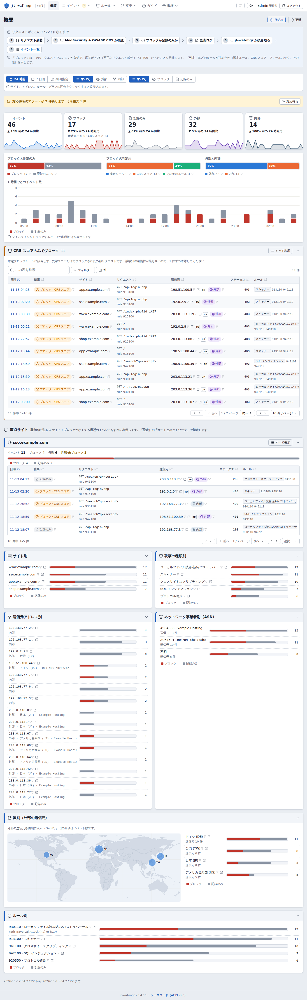
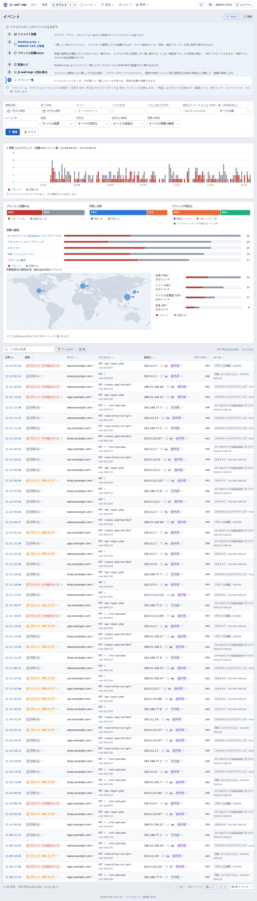
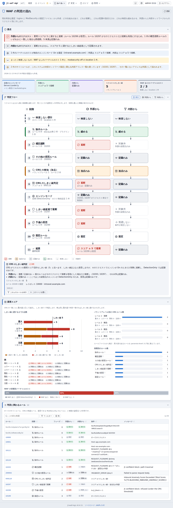
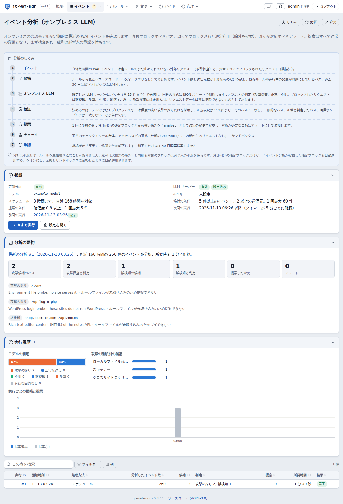
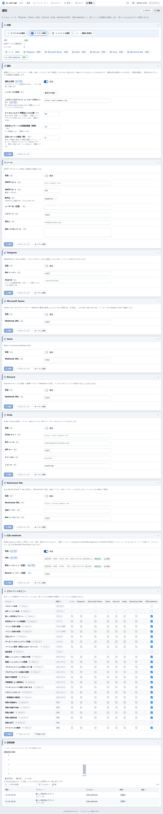
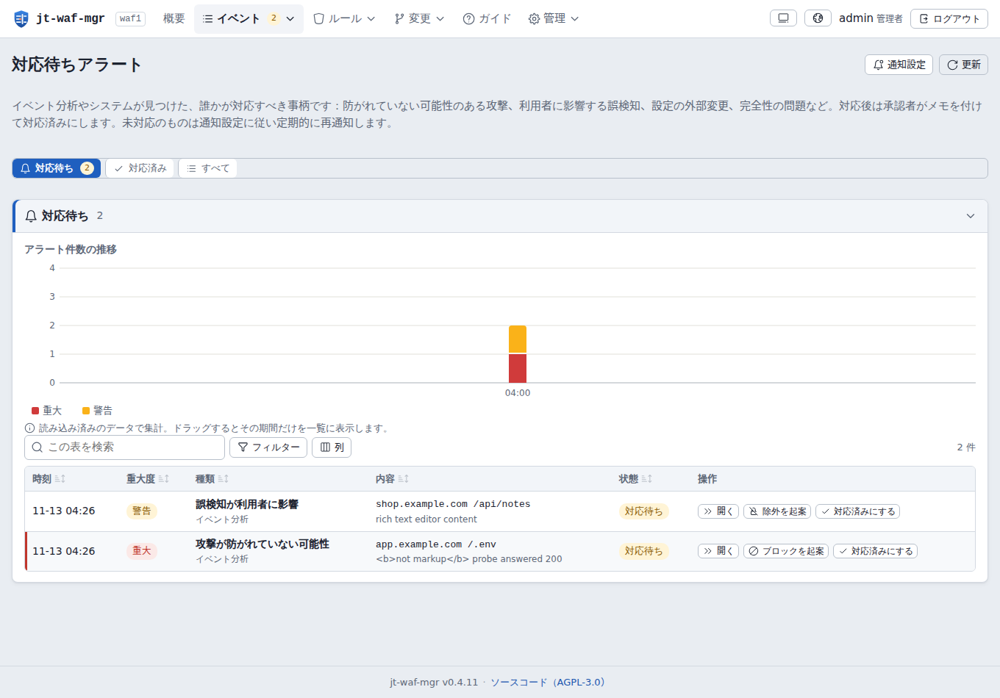
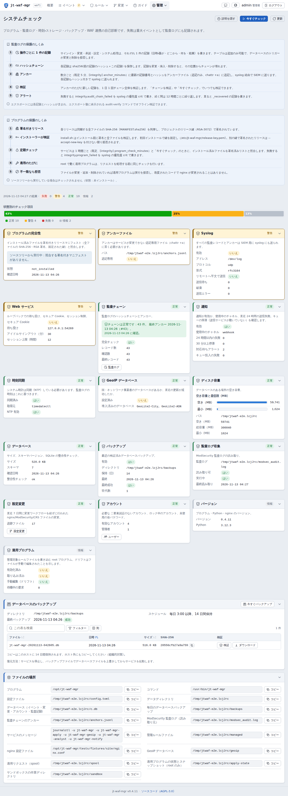

# jt-waf-mgr v0.4.11

[English](README.md) · [繁體中文](README_zh-TW.md) · **日本語**

[](LICENSE)
[](https://github.com/jasoncheng7115/jt-waf-mgr/commits/main)


**🌐 [プロジェクトサイト →](https://jasoncheng7115.github.io/jt-waf-mgr/?lang=ja)**

> **nginx + libmodsecurity v3 + OWASP CRS 4** のためのセルフホスト型 Web 管理ツールです。WAF が何をしたかを読み取り、
> 証拠の確認・サンドボックス試験・承認を経る変更フローでルールを調整し、オンプレミスの LLM にイベントを確認させ、重要な
> 事柄を Teams、Telegram、Zulip、Slack、Discord、Nextcloud Talk、メール、署名付き webhook に通知します。
>
> Jason Tools Co., Ltd. · ライセンス：AGPL-3.0



---

## なぜ jt-waf-mgr？

libmodsecurity v3 には管理画面がありません。ルール、除外、ブロックはすべて設定ファイルで、調整には本番のリバースプロキシ上で
JSON 監査ログを読み、ファイルを手で編集する必要があります。jt-waf-mgr は監査ログを読める画面にし、すべての変更を信頼できる
フローにします。

- **何が起きたかが分かる**：ブロック / 記録のみを、サイト、攻撃の種類、送信元（国とネットワーク事業者を含む）、ルール、時間
  ごとに表示。「CRS スコアだけでブロック」されたものを先頭に表示します（誤検知の可能性が最も高いため）。
- **安全に変更する**：テンプレート（除外、確定ブロック、マスク、プラグイン切替、エキスパート用の生ルール）→ 静的検査（正規表現、
  ReDoS）→ アクセスログからの証拠 → 本番設定と回帰サンプルによる使い捨ての nginx サンドボックス → 承認 → 小さな root
  プログラムが試験・reload・ヘルスチェックを行い、失敗時は自動で元に戻す → バージョンはワンクリックでロールバック。
- **モデルは手伝うが、単独では決めない**：自前の OpenAI 互換 LLM サーバーによる定期分析が、探査に対する狭いブロック、誤検知に
  対する最小の除外を提案し、アラートを出します。すべてプログラムが検証し、緩和は必ず人が承認します。
- **記録を信頼できる**：ハッシュチェーンの追記専用監査記録（アンカーはデータベース外と syslog）、署名付きリリース、すべての
  nginx / ModSecurity / CRS ファイルの指紋、ISO/IEC 27001:2022・台湾の資通安全管理法・OWASP Top 10:2025 との対照。

## 機能

- **収集**：ModSecurity JSON 監査ログ（copytruncate と名前変更によるローテーション、過大・破損レコードに対応）。パスワードや
  トークンなどの機密項目は**保存前に**マスクします。
- **概要とイベント**：タイムラインをドラッグして拡大、または最長 31 日の期間を指定。絞り込み条件は URL に保持。イベント詳細で
  一致したすべてのルールを表示し、ワンクリックで除外やブロックを起案。
- **WAF 判定フロー**：現在の設定から、これらのサイトでリクエストがどう判定されるか（サイトごとのエンジン、スコア、しきい値、
  除外、確定ブロック）を図示。
- **ルール**：各ルールの出所（OWASP CRS とバージョン、CRS プラグイン、取り込み時のインポート、人・API トークン・イベント分析
  による変更）、日ごとのヒット数、シンタックスハイライト。
- **変更フロー**：単独の変更または一括（1 回の承認・1 バージョン・1 回の reload）、ルールファイルのアップロード、証拠、
  サンドボックス、ヘルスチェック URL、承認ルール（提案者は承認不可。シングル管理者モードで自分の緩和を承認するにはワンタイム
  コードを再入力）、厳しい条件付きの自動強化、ロールバック。
- **イベント分析（オンプレミス LLM）**：ルールが見るパスで候補をまとめ、バッチごとに JSON スキーマで形式を制約したリクエストを
  送信。提案内容はモデルではなくプログラムが決めます（アンカー付きの狭い正規表現で、一般的なパス・回帰サンプル・組織自身が
  使うパスには一致しない。除外は一つの完全一致パスと特定のルール・項目のみで、承認にはワンタイムコードが必要）。実行ごとの要約。
- **対応待ちアラート**：防がれていない可能性のある攻撃、利用者に影響する誤検知、進行中の攻撃、設定の外部変更、完全性の問題、
  適用やバックアップの失敗。承認者が対応内容を記入するまで開いたままで、定期的に再通知します。
- **通知**：メール（SMTP、テキスト＋HTML）、Telegram、Microsoft Teams（Workflows / Adaptive Card）、Slack、Discord、Zulip、
  Nextcloud Talk、汎用 webhook（HMAC-SHA256 署名）。イベント × チャネルのマトリクス、チャネルごとのテスト送信、再送・上限・
  送信記録。リクエスト由来の値が書式・リンク・メンションになることはありません。
- **アカウント**：scrypt パスワード、approver / admin は二要素認証必須、ロックアウト、履歴と期限付きのパスワードポリシー、
  アカウントの期限と見直し。API トークンはスコープと許可送信元ネットワーク付き（提案はできるが承認は不可）。
- **完全性とコンプライアンス**：システムチェック、コンプライアンス、毎日検証されるバックアップとダウンロード（ワンタイム
  コード）、設定変更の履歴と原因判定（jt-waf-mgr、登録済みの自動化、外部）。
- **画面**：English・繁體中文・日本語、ライト / ダーク、スマートフォンとタブレット、GeoIP（MaxMind GeoLite2、専用の制限付き
  ジョブでダウンロード）と、ページ内で描画するリクエスト発信元の世界地図（地図サービスは使いません）。

| | |
|---|---|
|  |  |
|  |  |
|  |  |

## 要件

- Debian 12 / 13 または Ubuntu 22.04 / 24.04、**Python 3.11 以上（標準ライブラリのみ、pip もパッケージも不要）**：オフラインで
  インストールできます。
- nginx と ModSecurity-nginx コネクタ、libmodsecurity 3.0.9 以上、OWASP CRS 4.x、`SecAuditLogFormat JSON`。監査ログは
  `copytruncate` でローテーションしてください（libmodsecurity は reload 時にファイルを開き直しません）。
- 任意：イベント分析用のネットワーク上の OpenAI 互換 LLM サーバー（llama.cpp、vLLM、Ollama など）、GeoIP 用の MaxMind アカウント。

## インストール

```sh
openssl dgst -sha256 -verify release-key.pem -signature jt-waf-mgr-0.4.11.tar.gz.sig jt-waf-mgr-0.4.11.tar.gz
tar xzf jt-waf-mgr-0.4.11.tar.gz && cd jt-waf-mgr-0.4.11
sudo ./install.sh                             # 先にすべてのファイルとリリース署名を検証
sudo jt-waf-mgr check                         # nginx / ModSecurity 設定を解析
sudo jt-waf-mgr user add alice --role admin   # 一時パスワードを表示
```

管理画面の vhost（`/etc/jt-waf-mgr/nginx-vhost.conf.example`：内部ネットワークのみ、`127.0.0.1:8095` へ転送）を追加し、
`nginx -t`、reload、サインインしてパスワード変更と二要素認証の設定を行います。運用設定（GeoIP、LLM、分析、通知、ネットワーク、
ポリシー）は Web 画面で行い、`/etc/jt-waf-mgr/config.toml` には起動に必要な項目だけを置きます。

jt-waf-mgr にルールを変更させるには、適用プログラムを有効にし（`sudo ./install.sh --enable-apply`）、ヘルスチェック URL を
設定し、「ルール → 管理対象ルール」で既存のルールファイルを取り込みます（通常の変更と同様に admin が承認）。それまで nginx には
一切触れません。

### アップグレード

```sh
sudo ./upgrade.sh --check     # すべての検査のみ、何も変更しない
sudo ./upgrade.sh             # バックアップ、切替、検査。どこかで失敗すれば自動で元に戻す
sudo ./upgrade.sh --rollback  # 後で必要なら：アップグレード前のバージョン（とデータベース）に戻す
sudo jt-waf-mgr doctor        # いつでも健全性を確認
```

アップグレードはインストール済みのプログラムと固定された鍵で新しいリリースを検証し、変更の適用中は拒否し、
`/var/backups/jt-waf-mgr/` にバックアップを残し、すべてのアップグレード（とロールバック）を監査記録に残します。
`./uninstall.sh` はプログラムを削除し、データと設定は残します（`--purge` で併せて削除）。

## セキュリティ（OWASP Top 10:2025）

[SECURITY.md](SECURITY.md) と [docs/COMPLIANCE.md](docs/COMPLIANCE.md) を参照してください。脆弱性は非公開で報告してください。

- Web サービスは loopback のみで待ち受け、非特権で動作し、外部に接続しません。root で動くのは適用プログラムだけで、すべての
  リクエストを再検証し（許可されたディレクティブのみ、チェックサム、ディスク上の手動変更なし）、管理対象のファイルだけを書き
  込みます。GeoIP のダウンロード、LLM 分析、通知はそれぞれ専用の制限付きワンショットユニットで動きます。
- `unsafe-inline` を許可しない厳格な CSP。リクエスト由来の内容（URL、User-Agent、一致したデータ、モデルの文章）はすべて
  テキストとして表示します。
- 機密値はデータベースに入る前にマスクし、設定内のシークレットは書き込み専用です。
- A01：ロール viewer / operator / approver / admin、API トークンのスコープと送信元ネットワーク。トークンは承認できません。
- A04 / A07：scrypt、リプレイ防止付き TOTP、ロックアウト、機密操作のワンタイムコード（試行回数制限）。
- A08：署名付きリリースマニフェストをインストーラー・サービス・適用プログラムが検査。ハッシュチェーンの監査記録。
- A09：すべての書き込みを監査し、syslog にも送信（1 行の JSON、制御文字はエスケープ）。
- すべてのリリースはテスト計画（[TEST_PLAN.md](TEST_PLAN.md)）に合格する必要があります：単体テスト、全ページのブラウザ試験、
  全ルートのセキュリティ検査、OWASP ZAP のアクティブスキャン、独立レビュー、アップグレードとロールバックの試験。

## 技術

| 層 | 選択 |
|------|--------|
| バックエンド | Python 3.11+ 標準ライブラリ（http.server、sqlite3、hashlib.scrypt、tomllib、urllib、smtplib） |
| データベース | SQLite（WAL）、監査テーブルはトリガーで追記専用 |
| フロントエンド | Vue 3 · Vite · 独自 i18n（実行時コンパイルなし、CSP 対応）· Iconoir アイコン |
| WAF | nginx · libmodsecurity v3 · ModSecurity-nginx · OWASP CRS 4 |
| デプロイ | systemd ユニット（サービス、適用、GeoIP、分析、通知）。Docker 不要 |

## ディレクトリ構成

```
jt-waf-mgr/
├── jtwafmgr/            # 本体（収集、Web API、変更フロー、適用、分析、通知、完全性）
│   ├── collector/       # ModSecurity 監査ログの読み取り
│   ├── web/             # HTTP サーバーとルート
│   └── static/          # ビルド済みの Web 画面
├── frontend/            # Web 画面の Vue 3 ソース
├── deploy/              # systemd ユニット、nginx の例、リリース公開鍵、Wazuh ルール案、ZAP 基準
├── docs/                # 仕様、API 契約、コンプライアンス対照、プロジェクトサイト
├── tests/               # 単体・統合テスト（合成データのみ）
├── tools/               # ビルド、リリース、preflight、ブラウザ試験、セキュリティ検査、ZAP スキャン
├── install.sh · upgrade.sh · uninstall.sh
└── TEST_PLAN.md · TEST_CHECKLIST.md · SECURITY.md · CHANGELOG.md
```

## ライセンス

AGPL-3.0。変更したバージョンをネットワークサービスとして提供する場合は、利用者がソースコードを入手できるようにしてください
（未変更版はフッターのリンクで提供しています）。
