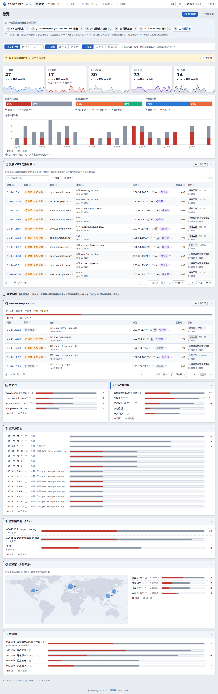
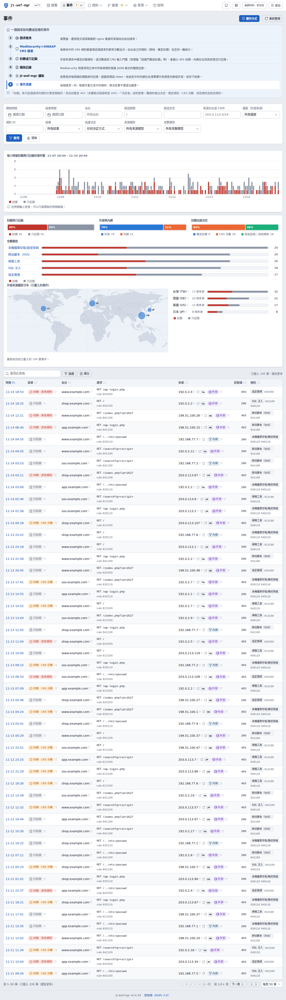
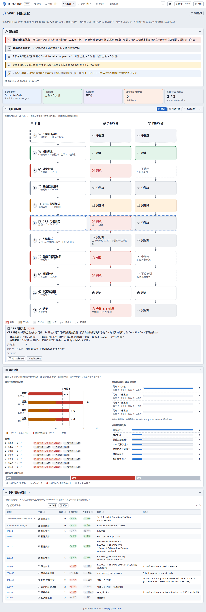
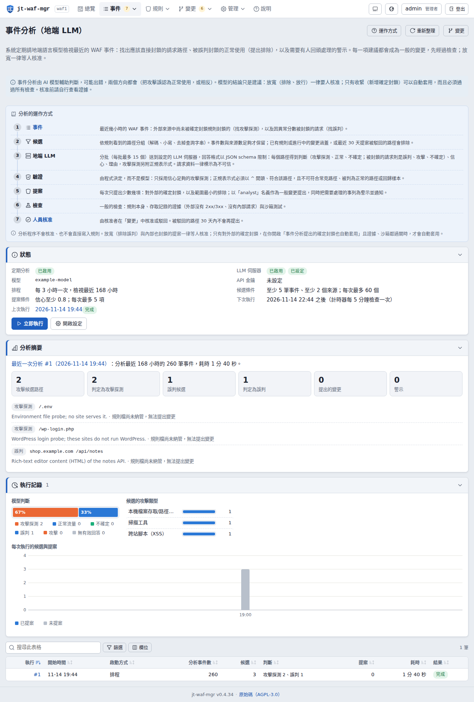
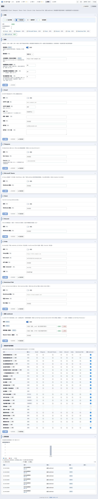
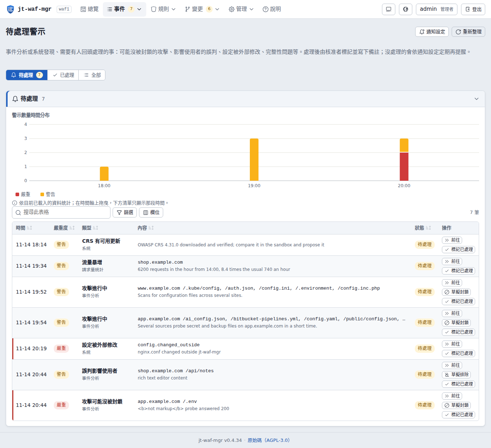
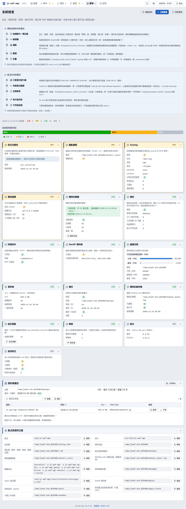
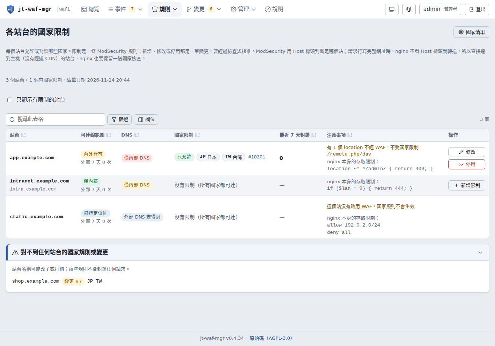
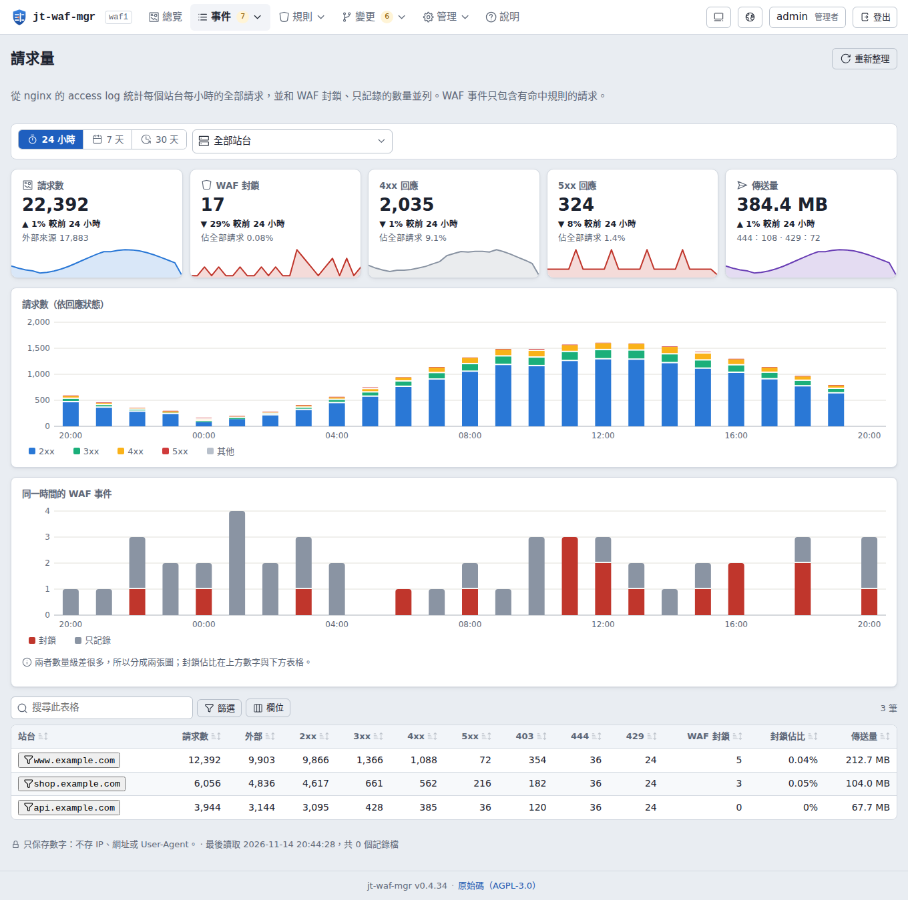

# jt-waf-mgr v0.4.34

[English](README.md) · **繁體中文** · [日本語](README_ja.md)

[](LICENSE)
[](https://github.com/jasoncheng7115/jt-waf-mgr/commits/main)


**🌐 [專案介紹網站 →](https://jasoncheng7115.github.io/jt-waf-mgr/?lang=zh-TW)**

> 自架的 **nginx + libmodsecurity v3 + OWASP CRS 4** 網頁管理工具：看懂 WAF 做了什麼；透過「證據檢查、沙箱測試、人員核准」
> 的變更流程調整規則；由你自己的地端 LLM 檢視事件；重要事情發到 Teams、Telegram、Zulip、Slack、Discord、Nextcloud Talk、
> Email 或簽章 webhook。
>
> Jason Tools Co., Ltd. · 授權：AGPL-3.0



---

## 為什麼需要 jt-waf-mgr？

libmodsecurity v3 沒有管理介面：規則、排除、封鎖都是設定檔，調整就得在正式的反向代理上讀 JSON 稽核記錄、手改檔案。
jt-waf-mgr 把稽核記錄變成看得懂的畫面，把每一次修改變成可以信任的流程：

- **看得懂發生了什麼**：封鎖 / 只記錄，依站台、攻擊類型、來源（含國家與網路業者）、規則與時間；「只因 CRS 分數被封鎖」
  的排在最前面，因為最可能是誤判。
- **安全地修改**：範本（排除、確定封鎖、遮蔽、外掛開關、專家模式原始規則）→ 靜態檢查（正規表示式、ReDoS）→ 存取記錄
  的證據 → 用正式設定加回歸樣本的拋棄式 nginx 沙箱 → 核准 → 小型 root 程式測試、reload、健康檢查，失敗自動還原 → 版本
  可一鍵退回。
- **讓模型幫忙，但不讓它自己決定**：排程分析用你自己的 OpenAI 相容 LLM 伺服器，對探測提出範圍很窄的封鎖、對誤判提出範圍
  最小的排除、發出警示；一切由程式驗證，放寬一律要人核准。
- **記錄可以信任**：雜湊鏈、只能追加的稽核記錄，錨點存在資料庫外與 syslog；發行檔有簽章；每個 nginx / ModSecurity /
  CRS 檔案都有指紋；提供 ISO/IEC 27001:2022、資通安全管理法、OWASP Top 10:2025 的合規對照。

## 功能

- **收集**：讀取 ModSecurity JSON 稽核記錄（支援 copytruncate 與改名輪替、過大與損壞的記錄）；密碼、token 等敏感欄位在
  **寫入之前**就遮蔽。
- **總覽與事件**：在時間軸上拖曳即可放大，或自訂最長 31 天的範圍；篩選條件存在網址；事件詳情列出每條命中的規則；一鍵草擬
  排除或封鎖。
- **暫時封鎖 IP**（0.4.24 新增，選用）：郵件主機的 fail2ban、SOAR 劇本或核准者可以暫時封鎖單一位址；一個 nginx deny
  清單涵蓋所有站台。見[暫時封鎖 IP](#暫時封鎖-ip選用)。
- **國家封鎖**（0.4.28 新增，選用）：讓站台只允許某些國家，或封鎖某些國家；清單來自五大區域網際網路註冊機構，每天更新。
  每個站台的限制都是一條規則，要經過變更流程；「規則 → 國家限制」頁列出每個站台允許哪些國家、封鎖了多少，
  可直接「修改」或「新增限制」。見[國家封鎖](#國家封鎖選用)。
- **請求量**（0.4.23 新增）：計算 nginx 存取記錄裡的每一個請求，依站台與小時統計（2xx、3xx、4xx、5xx、403、444、429、
  外部、位元組數；只有數字，不存 IP、網址或 User-Agent），和 WAF 封鎖的數量放在一起，讓 WAF 的數字有分母可以比較。
  在管理的「設定」→「請求量統計」啟用或關閉並設定警示；選用的警示（預設關閉）：流量暴增（該站台前 7 天同一時段平常量的
  N 倍）或大量 5xx 回應。
- **WAF 判斷流程**：依目前的實際設定畫出一個請求在這些站台上怎麼被判定（各站台引擎、計分、門檻、排除、確定封鎖）。
- **規則**：每條規則標示來源（OWASP CRS 與版本、CRS 外掛、納管時匯入、人員 / API 權杖 / 事件分析提出的變更）、每日命中、
  語法高亮。0.4.23 新增「撰寫者」，可篩選並顯示各撰寫者的規則數：OWASP CRS、OWASP CRS 外掛、第三方外掛、ModSecurity
  基本設定、jt-rules（jt-waf-mgr 依表單產生的規則與 jt-rules 規則包）、站台自寫（手寫的規則：納管時匯入、原始規則、
  nginx vhost 檔）。
- **變更流程**：單筆變更或合成一筆（一次核准、一個版本、一次 reload）、上傳規則檔、證據、沙箱、健康檢查網址、核准規則
  （提出者不能核准；單人模式核准自己的放寬要重新輸入一次性驗證碼）、嚴格條件下的自動收緊、退回。
- **事件分析（地端 LLM）**：依規則看到的路徑分組候選；每批一次、以 JSON schema 限制格式的請求；由程式而不是模型決定提什麼
  （錨定且很窄的正規表示式，不可符合常見路徑、回歸樣本或組織自己在用的路徑；排除只限單一精確路徑、特定規則與欄位，核准
  要一次性驗證碼）；外部來源探測機密、備份或設定檔名，或同一位址掃過很多路徑，由程式直接判為探測；之前判為攻擊的路徑
  不會因為一次「誤判」就放寬；每次執行都有摘要。
  **AI 可能出錯，兩個方向都會**：模型只提供建議；放寬一律要人核准，只有通過所有檢查的收緊可以自動套用。要用哪種 LLM
  請見[事件分析：建議的 LLM](#事件分析建議的-llm)。
- **待處理警示**：可能沒被封鎖的攻擊、影響使用者的誤判、進行中的攻擊、設定被外部修改、完整性問題、套用或備份失敗——在核准者
  寫下處理說明之前一直保持開啟，並定期提醒。
- **通知**：Email（SMTP，純文字＋HTML）、Telegram、Microsoft Teams（Workflows / Adaptive Card）、Slack、Discord、Zulip、
  Nextcloud Talk 與通用 webhook（HMAC-SHA256 簽章）；事件 × 管道矩陣；每個管道都能發送測試；重試、上限與發送記錄。來自請求
  的內容永遠不會變成格式、連結或提及。
- **OWASP CRS 更新**（選用，預設關閉）：受限的每日檢查，取使用中主版本的最新版，發布滿一週才下載，只保留有 CRS 官方金鑰
  有效簽章的版本並放進暫存區；CRS 頁顯示使用中、最新與已驗證的版本。切換到新版（或退回保留的舊版）是一筆變更：新舊兩版在沙箱
  跑同一批最近的請求比對，由人核准，root 程式重新驗章、自己解開、切換 crs 連結，任何一步失敗就切回；保留 3 個版本可以退回。
  還沒有 CRS 的主機也能用同樣的流程安裝 CRS 4（Include 加在 modsecurity.conf 之後）。
- **外送記錄（syslog / SIEM）**：最多 8 個目的地，各自選協定（本機 socket、UDP、TCP、TLS）、訊息格式（JSON、CEF、LEEF 2.0、
  GELF 1.1、key=value）與送出內容（稽核記錄、WAF 事件、警示）；各有自己的佇列與重試；測試送出會顯示實際送出的內容。
- **帳號**：scrypt 密碼、approver / admin 必須雙因素驗證、鎖定、含歷史與期限的密碼政策、帳號到期與審查；API 權杖有範圍與
  允許來源網段（權杖可以提案，永遠不能核准）。主機上的救援指令請見[帳號與救援](#帳號與救援)。
- **完整性與合規**：系統檢查頁、合規頁、每日驗證過的備份與下載（需一次性驗證碼）、設定異動記錄與來源判斷（jt-waf-mgr、
  已登記的自動化或外部）；外部修改會顯示每個檔案改了什麼（看起來像機密的值會遮蔽），以及當時誰登入了主機。
- **介面**：English、繁體中文、日本語；淺色與深色；手機與平板；GeoIP（MaxMind GeoLite2，由獨立的受限程序下載），以及在頁面內繪製的請求來源世界地圖（不使用任何地圖服務）。

| | |
|---|---|
|  |  |
|  |  |
|  |  |
|  |  |

## 需求

- Debian 12 / 13 或 Ubuntu 24.04（22.04 的 libmodsecurity 套件太舊，要自行編譯 3.0.9 以上），**Python 3.11 以上，只用標準函式庫，不需要 pip 或任何套件**：可以離線安裝。
- nginx 加 ModSecurity-nginx 連接器、libmodsecurity 3.0.9 以上、`SecAuditLogFormat JSON`；OWASP CRS 4.x 可以由 jt-waf-mgr
  下載、驗證並安裝（見 [OWASP CRS](#owasp-crs)）；稽核記錄請用 `copytruncate` 輪替（libmodsecurity 在 reload 時不會重開檔案）。從全新的 nginx 開始，或還沒有 CRS 4：請看
  [ModSecurity 安裝手冊](docs/MODSECURITY.zh-TW.md)；沒有對外網路的主機請看[離線安裝與更新](docs/OFFLINE.zh-TW.md)。沒有站台規則檔也能納管（會在 CRS 規則前後加入空的受管理檔案）。
- 選用：網路上的 OpenAI 相容地端 LLM 伺服器（llama.cpp、vLLM、Ollama…）供事件分析（見[建議的 LLM](#事件分析建議的-llm)）；
  GeoIP 需要 MaxMind 帳號。

## 安裝

```sh
openssl dgst -sha256 -verify release-key.pem -signature jt-waf-mgr-0.4.34.tar.gz.sig jt-waf-mgr-0.4.34.tar.gz
tar xzf jt-waf-mgr-0.4.34.tar.gz && cd jt-waf-mgr-0.4.34
sudo ./install.sh                             # 先驗證每個檔案與發行檔簽章
sudo jt-waf-mgr check                         # 解析 nginx / ModSecurity 設定
sudo jt-waf-mgr user add alice --role admin   # 印出臨時密碼
```

### 連到管理介面

服務只聽 `127.0.0.1:8095`（`/etc/jt-waf-mgr/config.toml` 的 `[server] listen`），不會直接對外開放，而是由 nginx 的管理
介面 vhost 轉送過去。發行檔會把範例 vhost 裝在 `/etc/jt-waf-mgr/nginx-vhost.conf.example`，請複製到 nginx 的 vhost 目錄，
例如：

```sh
sudo cp /etc/jt-waf-mgr/nginx-vhost.conf.example /etc/nginx/sites-available/waf.example.com.conf
sudo ln -s /etc/nginx/sites-available/waf.example.com.conf /etc/nginx/sites-enabled/
# （或複製到 /etc/nginx/conf.d/waf.example.com.conf）
```

在複製出來的檔案裡設定：

- `server_name`：要開啟的名稱，例如 `waf.example.com`；
- `ssl_certificate` 與 `ssl_certificate_key`：憑證（見下方）；
- `allow` 那幾行：只放內部網路（或更窄：管理者的網段），其餘維持 `deny all`。

接著執行 `sudo nginx -t && sudo systemctl reload nginx`。這個 vhost 刻意設成 `modsecurity off`：介面會顯示攻擊字串，
開著 WAF 會讓它自己觸發 WAF。選用：範例裡加了註解的 `limit_req` 區塊可以在登入前多一道防暴力破解的限制。

憑證可以用：

- 組織內部的 CA，或既有的萬用字元憑證；
- Let's Encrypt：管理介面只開放內部網路，HTTP-01 驗證通常連不進來；請改用 DNS-01 驗證（certbot 加上你的 DNS 業者外掛），
  或在對外的主機上申請後再複製過來；
- 只限測試環境：自簽憑證（瀏覽器會出現警告）：

```sh
sudo openssl req -x509 -newkey rsa:3072 -nodes -days 825 -keyout /etc/ssl/private/waf.key -out /etc/ssl/certs/waf.crt -subj "/CN=waf.example.com" -addext "subjectAltName=DNS:waf.example.com"
```

然後開啟 `https://waf.example.com`（你設定的名稱），用 `jt-waf-mgr user add` 印出的臨時密碼登入。第一次登入一定要改密碼
並設定 TOTP 雙因素驗證。營運設定（GeoIP、LLM、分析、通知、請求量、網路、政策）都在網頁上設定；`/etc/jt-waf-mgr/config.toml`
只放程式啟動需要的項目。

### 讓 jt-waf-mgr 修改規則

jt-waf-mgr 只寫 ModSecurity 的檔案，永遠不寫 nginx 設定。它會讀 nginx 設定（找出站台與 ModSecurity 主設定檔）、執行
`nginx -t` 並 reload nginx。管理介面的 vhost 與 nginx 裡的 `modsecurity on;` 是管理者自己做一次的修改。唯一的例外是選用的暫時封鎖 IP 清單：只有 `deny` 行的一個檔案，由你自己 include 一次。

要讓 jt-waf-mgr 修改規則：啟用套用程式（`sudo ./install.sh --enable-apply`）、設定健康檢查網址，再到「規則 → 受管理的
規則」納管現有規則檔（由 admin 核准，跟一般變更一樣）。在那之前什麼都不會寫入。沒有站台規則檔也能納管。

### OWASP CRS

CRS 由 jt-waf-mgr 處理。新主機只需要 nginx 加 ModSecurity 模組、含 `SecAuditLogFormat JSON` 的 `modsecurity.conf`、
一個 Include `modsecurity.conf` 的主設定檔，以及 nginx 裡的 `modsecurity on;` 與 `modsecurity_rules_file …`
（[ModSecurity 安裝手冊](docs/MODSECURITY.zh-TW.md)）。接著：

1. 在 CRS 頁開啟「由本系統保持 CRS 最新」。
2. jt-waf-mgr 會在最新的 CRS 4.x 發布滿 `wait_days`（預設 7 天）後下載，並用釘選的 CRS 簽章金鑰驗證。
3. 按「在沙箱比對並提出安裝」建立一筆變更。
4. 由人核准後，jt-waf-mgr 安裝 `crs-<版本>`、建立 `crs` 連結與 `crs-setup.conf`，並在 `modsecurity.conf` 之後插入 Include。
5. 接著納管，在 CRS 規則前後加上 jt-waf-mgr 受管理的規則檔。

之後的 CRS 更新也一樣：下載、驗證、沙箱比對、由人核准、安裝；保留 3 個版本可以退回。也可以自己手動安裝 CRS（見安裝手冊）。

### 暫時封鎖 IP（選用）

其他系統（例如網頁信箱在這台代理後面的郵件主機上的 fail2ban）可以透過 API（scope `blocks:write`）暫時封鎖單一位址；
核准者也可以在「封鎖中的 IP」頁操作。jt-waf-mgr 把清單寫進一個只有 `deny` 行的 nginx 檔案，涵蓋所有站台，沒開
ModSecurity 的也算。使用方式：

1. 建立檔案，並在 nginx.conf 的 `http { }` 裡 include 一次，然後測試並 reload：
   ```sh
   sudo install -D -m 644 /dev/null /etc/nginx/jt-waf-mgr/blocked-ips.conf
   # 在 nginx.conf 的 http { } 裡：   include /etc/nginx/jt-waf-mgr/blocked-ips.conf;
   sudo nginx -t && sudo systemctl reload nginx
   ```
2. 設定 → 暫時封鎖 IP：啟用，並列出永遠不能封鎖的網段（例如站台前面的 CDN）。
3. 管理 → API 權杖：建立有 `blocks:write`（與 `blocks:read`）的權杖，來源限定為呼叫端主機的位址。
4. 範例：透過 API 封鎖與解除的 fail2ban 動作：
   ```ini
   # /etc/fail2ban/action.d/jt-waf-block.conf  (chmod 600: it holds the token)
   [Definition]
   actionban   = curl -fsS -m 10 -X POST -H "Authorization: Bearer <token>" -H "Content-Type: application/json" \
                 -d '{"ip": "<ip>", "ttl": <bantime>, "source": "<source>", "reason": "fail2ban <name>"}' <waf>/api/v1/blocks
   actionunban = curl -fsS -m 10 -X DELETE -H "Authorization: Bearer <token>" "<waf>/api/v1/blocks/<ip>?source=<source>"
   [Init]
   waf    = https://waf.example.com
   token  = jwm_...
   source = mail1/<name>
   ```
   jail 裡改用 `action = jt-waf-block`。`bantime` 要在 60 秒到 7 天之間（更長或永久會被拒絕）；jail 原本的 `ignoreip` 照樣
   排除內部位址（反正也會被拒絕）。
   也可以在 設定 → 暫時封鎖 IP 開啟「自動封鎖猜機密檔的來源」：外部位址一小時內要求 5 個不同的機密或設定檔名，就由程式規則封鎖 24 小時。
   它看的是 WAF 事件，只計算被拒絕或找不到（4xx/5xx）的檔名，其中至少要有一個明確的機密檔（.env、.git、金鑰、傾印、備份檔）；
   只要有任何一個這類檔名拿到 2xx/3xx，就不自動封鎖，留給人判斷。它不經過變更流程、會在所有站台封鎖，所以預設關閉。

封鎖預設 24 小時，權杖最長 7 天、手動最長 30 天；核准者可以延長，管理者可以在網頁上設為永久封鎖（需填理由，權杖與自動規則
都不能設永久）。內部網路、已知掃描器、信任的代理與保護清單永遠不會被
封鎖。nginx 比對的是 `real_ip` 之後的位址，所以在 CDN 後面的站台要設定 `set_real_ip_from` / `real_ip_header`。自己有
`allow` / `deny` 的 server 與 location 不會繼承這份清單，「封鎖中的 IP」頁會列出。封鎖約一分鐘內對新的請求生效；已經開著的連線（WebSocket）會持續到自己結束。詳細說明見 [API 手冊](docs/API.zh-TW.md)
第 4.9 節。

### 國家封鎖（選用）

依請求來源國家限制個別站台：只允許列出的國家（例如「只限台灣與日本」），或封鎖列出的國家。每個限制都是一條 ModSecurity
規則，和其他規則一樣經過變更流程（檢查、沙箱、核准、可還原）；位址清單屬於資料，更新時不經過變更流程。

1. 設定 → 國家封鎖：啟用，再按「立即更新」。另一個受限的獨立程序會下載五大註冊機構的 delegated 檔（APNIC、ARIN、
   RIPE NCC、LACNIC、AFRINIC，合計約 28 MB），逐一用官方的 MD5 檔與檔案本身的筆數驗證，五個都通過才替換清單；之後每天一次。
   網頁服務本身不會連外。
2. 變更 → 新增 → 國家封鎖：選站台、「只允許這些國家」或「封鎖這些國家」、國家。檢查會從存取記錄算出這條規則會封鎖多少請求與
   位址，以及其中有多少原本是成功回應（2xx/3xx，代表會被封鎖的真實使用者）；沙箱會測試允許國家、被封鎖國家與內部各一個請求。
3. 核准後，root 套用程式寫入規則讀取的清單檔（`/etc/nginx/modsec/jt-waf-mgr/countries/`），測試 nginx 後 reload。

永遠不會被封鎖：內部網路、已知掃描器、信任的代理與保護清單（設定 → 暫時封鎖 IP），所以不會連站台前面的 CDN 一起封鎖。
在 CDN 後面的站台要設定 `set_real_ip_from` / `real_ip_header`。規則在 ModSecurity 裡執行，設了 `modsecurity off` 的 location
不在範圍內。註冊資料表示的是位址區塊在哪裡註冊，不是使用者實際所在（VPN、雲端區域或漫遊的手機可能在別處）。

### 帳號與救援

在主機上以 root 執行：

```sh
sudo jt-waf-mgr user list                       # 帳號、角色與狀態（disabled、totp、must-change）
sudo jt-waf-mgr user add alice --role approver  # 角色：viewer（預設）、operator、approver、admin
sudo jt-waf-mgr user unlock alice
sudo jt-waf-mgr user reset alice
sudo jt-waf-mgr user passwd alice
sudo jt-waf-mgr user disable alice              # 以及 enable
```

- `add`：印出臨時密碼，第一次登入時必須更改。
- `unlock`：解除登入失敗造成的鎖定。
- `reset`：給一組新的臨時密碼、清除 TOTP，登入時強制改密碼；手機遺失時就用這個救援。
- `passwd`：以互動方式設定密碼。
- `disable` 與 `enable`：停用與重新啟用帳號。
- 以上每一項變更都寫進稽核記錄。

### 升級

```sh
sudo ./upgrade.sh --check     # 只做所有檢查，不改任何東西
sudo ./upgrade.sh             # 備份、切換、檢查；任何一步失敗自動還原
sudo ./upgrade.sh --rollback  # 之後需要時：回到升級前的版本（與資料庫）
sudo jt-waf-mgr doctor        # 隨時查看健康狀態
```

升級會用已安裝的程式與釘選的金鑰驗證新版本、有變更正在套用時拒絕升級、在 `/var/backups/jt-waf-mgr/` 保留備份，並把每次
升級（與還原）寫進稽核記錄。

### 移除

```sh
sudo ./uninstall.sh           # 移除服務與程式，保留資料與設定
sudo ./uninstall.sh --purge   # 連同 /var/lib/jt-waf-mgr、/etc/jt-waf-mgr 與 jtwaf 帳號一併移除
```

不會動到 nginx 設定：管理介面的 vhost 請自行移除。如果已經納管規則檔，`/etc/nginx/modsec/jt-waf-mgr/` 裡的受管理檔案
會保留，nginx 照常載入；之後請自行維護。

## 事件分析：建議的 LLM

事件分析一律使用你自己的地端 LLM 伺服器。

- **伺服器**：OpenAI 相容（llama.cpp server、vLLM、Ollama），並支援以 JSON schema 限制回答格式；不支援時改用一般的 JSON
  模式，回答比較不可靠。
- **模型**：約 14B 參數以上的指令模型，4-bit 量化或更好；建議 27–32B 的 dense 模型或 30B 級的 MoE。版本：Qwen 要
  3.8 以上、Gemma 要 4 以上（較舊的版本不建議），或 gpt-oss-20b。
- **上下文長度**：至少 16k tokens。實測：一批 11 個候選約用了 3k 輸入與 3.5k 輸出 tokens，在正式機上花了約 85 秒。
- **較小的模型**（8B 以下）或 2–3-bit 量化，每次執行的判斷比較容易前後矛盾：正式環境曾有 3-bit 量化的模型把同一個探測兩次
  判為攻擊、一次判為誤判。jt-waf-mgr 用程式端的掃描器特徵規則與判斷歷史來抵銷，但模型強一點還是有幫助。
- **硬體較慢時**：在「設定」把 LLM 逾時調高（最多 900 秒）。

AI 可能判斷錯誤。自動套用只會收緊（允許 → 封鎖）；放寬一律要人核准。

## 與其他系統整合

- **Wazuh**：[deploy/wazuh](deploy/wazuh/README.md) 附有 jt-waf-mgr 自身記錄的 decoder 與規則（以 syslog 送出稽核記錄與
  事件）；主動回應可以呼叫 IP 封鎖 API。
- **jt-wazuh-mgr**（Jason Tools 另一個管理 Wazuh 的專案）用自己的 API 權杖提出 WAF 變更與暫時封鎖，永遠不能核准。
- **Graylog**：「設定 → 外送記錄」選 GELF 格式，以 UDP、TCP 或 TLS 送到 GELF input；站台、規則、結果、來源、國家都是
  各自獨立的欄位。
- **其他 SIEM**：最多 8 個 syslog 目的地，各自設定協定、格式（JSON、CEF、LEEF、GELF、key=value、RFC 3164 / 5424）
  與內容（稽核記錄、事件、警示）。
- **fail2ban**：「封鎖中的 IP」頁附有透過 API 封鎖與解除的現成動作。
- **聊天與 webhook**：E-mail、Telegram、Teams、Slack、Discord、Zulip、Nextcloud Talk，以及 HMAC 簽章的 webhook。

## 介接 API

SIEM、SOAR 劇本或指令稿用 API 權杖連線（由 admin 建立，有範圍與允許的來源位址；權杖可以提出變更，永遠不能核准）。
請見 [API 介接手冊](docs/API.zh-TW.md)。

## 安全（OWASP Top 10:2025）

請見 [SECURITY.md](SECURITY.md) 與 [docs/COMPLIANCE.zh-TW.md](docs/COMPLIANCE.zh-TW.md)。發現弱點請私下回報。

- 網頁服務只聽 loopback、以非特權帳號執行、不會對外連線；只有套用程式是 root，它會重新驗證每個請求（只允許特定指令、
  檢查碼、磁碟上不能有手動修改），也只寫受管理的檔案。GeoIP 下載、LLM 分析與通知各自在受限的一次性 unit 裡執行。
- 嚴格的 CSP（不允許 `unsafe-inline`）；來自請求的內容（網址、User-Agent、命中資料、模型的文字）一律以純文字顯示。
- 敏感值在進資料庫前就遮蔽；設定裡的金鑰只能寫入、不能讀回。
- A01：角色 viewer / operator / approver / admin、API 權杖範圍與來源網段；權杖永遠不能核准。
- A04 / A07：scrypt、可防重放的 TOTP、鎖定、敏感操作的一次性驗證碼（限制錯誤次數）。
- A08：發行清單簽章，由安裝程式、服務與套用程式檢查；雜湊鏈稽核記錄。
- A09：每個寫入都有稽核，也送到 syslog（一行 JSON，控制字元已跳脫）。
- 每次發版都要通過測試計畫（[TEST_PLAN.md](TEST_PLAN.md)）：單元測試、每一頁的瀏覽器測試、每個路由的安全檢測、OWASP ZAP
  主動掃描、獨立審查、升級與還原測試。

## 技術

| 層 | 選擇 |
|------|--------|
| 後端 | Python 3.11+ 標準函式庫（http.server、sqlite3、hashlib.scrypt、tomllib、urllib、smtplib） |
| 資料庫 | SQLite（WAL），稽核表以觸發器限制只能追加 |
| 前端 | Vue 3 · Vite · 自寫 i18n（不在執行期編譯，符合 CSP）· Iconoir 圖示 |
| WAF | nginx · libmodsecurity v3 · ModSecurity-nginx · OWASP CRS 4 |
| 部署 | systemd unit（服務、套用、GeoIP、分析、通知）；不需要 Docker |

## 目錄結構

```
jt-waf-mgr/
├── jtwafmgr/            # 程式本體（收集、網頁 API、變更流程、套用、分析、通知、完整性）
│   ├── collector/       # ModSecurity 稽核記錄讀取
│   ├── web/             # HTTP 伺服器與路由
│   └── static/          # 建置好的網頁介面
├── frontend/            # 網頁介面的 Vue 3 原始碼
├── deploy/              # systemd unit、nginx 範例、發行公鑰、Wazuh 規則草稿、ZAP 基準
├── docs/                # 規格、API 契約、合規對照、專案網站
├── tests/               # 單元與整合測試（只用合成資料）
├── tools/               # 建置、發行、preflight、瀏覽器測試、安全檢測、ZAP 掃描
├── install.sh · upgrade.sh · uninstall.sh
└── TEST_PLAN.md · TEST_CHECKLIST.md · SECURITY.md · CHANGELOG.md
```

## 授權

AGPL-3.0。如果你把修改過的版本作為網路服務提供，必須讓使用者取得原始碼（未修改版本由頁尾連結提供）。
